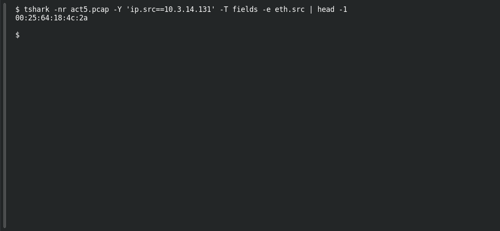

# ACT 5 — Final Incident: Host One MAC

**Platform:** PCGCTF · **Challenge ID:** 290 · **Category:** Network Forensics · **Points:** 100

**Status:** Answer backed by the Act 5 capture. Exact PCGCTF submission not independently re-confirmed.

## The challenge

MAC for 10.3.14.131.

## Solving it

Use [the shared capture](../../unsolved/network-forensics/289-act-5-final-incident-map-the-network/files/2017-02-11-traffic-analysis-exercise.pcap) as `act5.pcap` for the commands below.

```sh
tshark -nr act5.pcap -Y 'ip.src==10.3.14.131' -T fields -e eth.src | head -1
```

```text
00:25:64:18:4c:2a
```

## Screenshot

Fresh local reproduction using the command described above.



## Flag

```text
pcgCTF{00:25:64:18:4c:2a}
```

## Reference

- [Original challenge description](../../unsolved/network-forensics/290-act-5-final-incident-host-one-mac/README.md)
