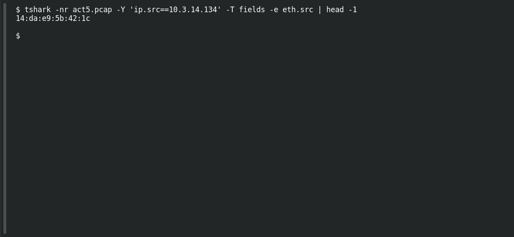

# ACT 5 — Final Incident: Host Two MAC

**Platform:** PCGCTF · **Challenge ID:** 291 · **Category:** Network Forensics · **Points:** 100

**Status:** Answer backed by the Act 5 capture. Exact PCGCTF submission not independently re-confirmed.

## The challenge

MAC for 10.3.14.134.

## Solving it

Use [the shared capture](../../unsolved/network-forensics/289-act-5-final-incident-map-the-network/files/2017-02-11-traffic-analysis-exercise.pcap) as `act5.pcap` for the commands below.

```sh
tshark -nr act5.pcap -Y 'ip.src==10.3.14.134' -T fields -e eth.src | head -1
```

```text
14:da:e9:5b:42:1c
```

## Screenshot

Fresh local reproduction using the command described above.



## Flag

```text
pcgCTF{14:da:e9:5b:42:1c}
```

## Reference

- [Original challenge description](../../unsolved/network-forensics/291-act-5-final-incident-host-two-mac/README.md)
