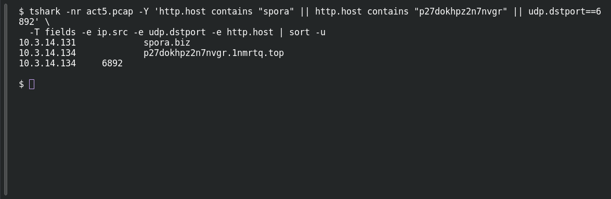

# ACT 5 — Final Incident: Find the Victims

**Platform:** PCGCTF · **Challenge ID:** 293 · **Category:** Network Forensics · **Points:** 100

**Status:** Answer backed by the Act 5 capture. Exact PCGCTF submission not independently re-confirmed.

**Evidence:** Packets 8820, 11043, 16762 · TCP streams 179, 299 · UDP stream 197 · [2017-02-11-traffic-analysis-exercise.pcap](../../unsolved/network-forensics/289-act-5-final-incident-map-the-network/files/2017-02-11-traffic-analysis-exercise.pcap).

## The challenge

Which two of the three clients show ransomware-specific activity?

## Solving it

Use [the shared capture](../../unsolved/network-forensics/289-act-5-final-incident-map-the-network/files/2017-02-11-traffic-analysis-exercise.pcap) as `act5.pcap` for the commands below.

Check which source addresses send traffic matching the Spora portal, the Cerber portal, or the Cerber UDP/6892 pattern:

```sh
tshark -nr act5.pcap -Y 'http.host contains "spora" || http.host contains "p27dokhpz2n7nvgr" || udp.dstport==6892' \
  -T fields -e ip.src -e udp.dstport -e http.host | sort -u
```

```text
10.3.14.131		spora.biz
10.3.14.134		p27dokhpz2n7nvgr.1nmrtq.top
10.3.14.134	6892
```

- `10.3.14.131` → `spora.biz` (Spora)
- `10.3.14.134` → Cerber `.top` domain + the UDP 6892 spray

The third host (10.3.14.135) shows neither, so the two victims are 131 and 134.

## Screenshot

Fresh local reproduction using the command described above.



## Flag

```text
pcgCTF{10.3.14.131_10.3.14.134}
```

## Takeaway

Attribute by the specific IOC per host — a ransom-portal domain for one, Cerber's UDP beacon for the other — rather than lumping all three together.

## Reference

- [Original challenge description](../../unsolved/network-forensics/293-act-5-final-incident-find-the-victims/README.md)
