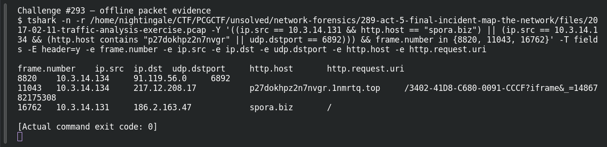

# ACT 5 — Final Incident: Find the Victims

**Platform:** PCGCTF · **Challenge ID:** 293 · **Category:** Network Forensics · **Points:** 100

**Status:** Answer backed by the Act 5 capture. Exact PCGCTF submission not independently re-confirmed.

## The challenge

Which two of the three clients show ransomware-specific activity?

## Solving it

I looked at each host's outbound activity for ransomware IOCs:

```sh
tshark -nr act5.pcap -Y 'http.request || udp.dstport==6892' \
  -T fields -e ip.src -e udp.dstport -e http.host -e http.request.uri
```

```text
10.3.14.134  6892   —                          —
10.3.14.134  —      p27dokhpz2n7nvgr.1nmrtq.top /3402-...        (Cerber)
10.3.14.131  —      spora.biz                  /                (Spora)
```

- `10.3.14.131` → `spora.biz` (Spora)
- `10.3.14.134` → Cerber `.top` domain + the UDP 6892 spray

The third host (10.3.14.135) shows neither, so the two victims are 131 and 134.

## Screenshot



## Flag

```text
pcgCTF{10.3.14.131_10.3.14.134}
```

## Takeaway

Attribute by the specific IOC per host — a ransom-portal domain for one, Cerber's UDP beacon for the other — rather than lumping all three together.

## Reference

- [Original challenge description](../../solved/network-forensics/293-act-5-final-incident-find-the-victims/README.md)
