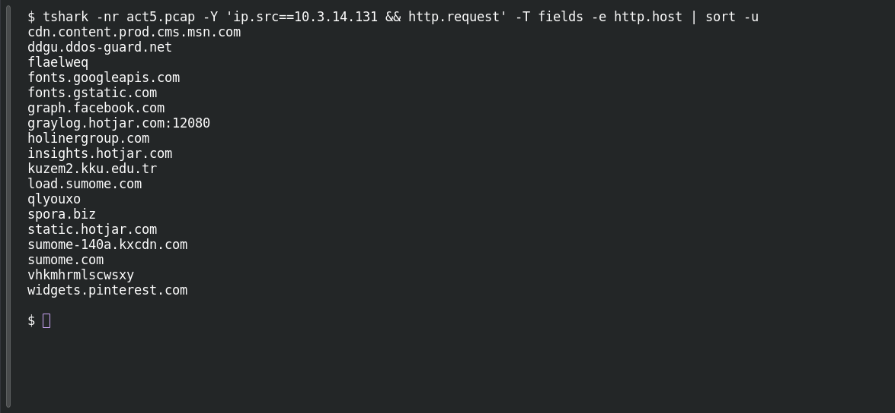

# ACT 5 — Final Incident: First Ransomware

**Platform:** PCGCTF · **Challenge ID:** 294 · **Category:** Network Forensics · **Points:** 100

**Status:** Answer backed by the Act 5 capture. Exact PCGCTF submission not independently re-confirmed.

## The challenge

Attribute the ransomware on 10.3.14.131.

## Solving it

Use [the shared capture](../../unsolved/network-forensics/289-act-5-final-incident-map-the-network/files/2017-02-11-traffic-analysis-exercise.pcap) as `act5.pcap` for the commands below.

That host repeatedly contacts the Spora payment domain:

```sh
tshark -nr act5.pcap -Y 'ip.src==10.3.14.131 && http.request' -T fields -e http.host | sort -u
```

```text
cdn.content.prod.cms.msn.com
ddgu.ddos-guard.net
flaelweq
fonts.googleapis.com
fonts.gstatic.com
graph.facebook.com
graylog.hotjar.com:12080
holinergroup.com
insights.hotjar.com
kuzem2.kku.edu.tr
load.sumome.com
qlyouxo
spora.biz
static.hotjar.com
sumome-140a.kxcdn.com
sumome.com
vhkmhrmlscwsxy
widgets.pinterest.com
```

Requests to `spora.biz` → the family is Spora.

## Screenshot

Fresh local reproduction using the command described above.



## Flag

```text
pcgCTF{Spora}
```

## Takeaway

Here the payment/portal domain names the family outright — `spora.biz` is Spora ransomware.

## Reference

- [Original challenge description](../../unsolved/network-forensics/294-act-5-final-incident-first-ransomware/README.md)
