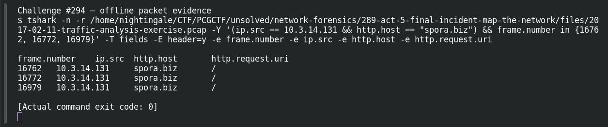

# ACT 5 — Final Incident: First Ransomware

**Platform:** PCGCTF · **Challenge ID:** 294 · **Category:** Network Forensics · **Points:** 100

**Status:** Answer backed by the Act 5 capture. Exact PCGCTF submission not independently re-confirmed.

## The challenge

Attribute the ransomware on 10.3.14.131.

## Solving it

That host repeatedly contacts a very on-the-nose domain:

```sh
tshark -nr act5.pcap -Y 'ip.src==10.3.14.131 && http.request' -T fields -e http.host
```

```text
spora.biz
spora.biz
spora.biz
```

Requests to `spora.biz` → the family is Spora.

## Screenshot



## Flag

```text
pcgCTF{Spora}
```

## Takeaway

Here the payment/portal domain names the family outright — `spora.biz` is Spora ransomware.

## Reference

- [Original challenge description](../../solved/network-forensics/294-act-5-final-incident-first-ransomware/README.md)
