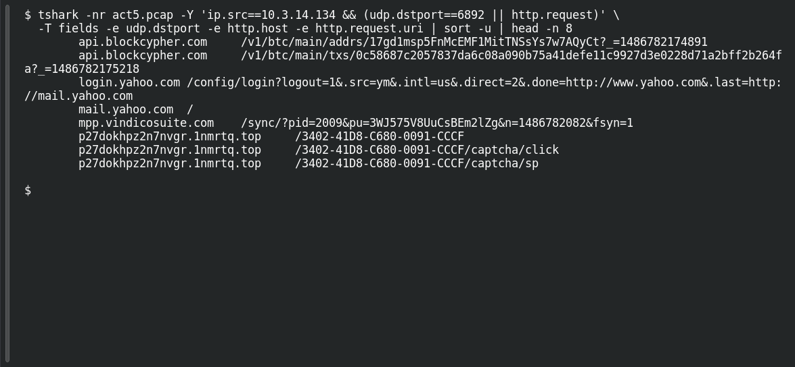

# ACT 5 — Final Incident: Second Ransomware

**Platform:** PCGCTF · **Challenge ID:** 295 · **Category:** Network Forensics · **Points:** 100

**Status:** Answer backed by the Act 5 capture. Exact PCGCTF submission not independently re-confirmed.

## The challenge

Attribute the ransomware on 10.3.14.134.

## Solving it

Use [the shared capture](../../unsolved/network-forensics/289-act-5-final-incident-map-the-network/files/2017-02-11-traffic-analysis-exercise.pcap) as `act5.pcap` for the commands below.

This host shows the classic Cerber pair — a UDP spray to port 6892 and a `.top` ransom-portal URL with a hex victim ID:

```sh
tshark -nr act5.pcap -Y 'ip.src==10.3.14.134 && (udp.dstport==6892 || http.request)' \
  -T fields -e udp.dstport -e http.host -e http.request.uri | sort -u | head -n 8
```

```text
api.blockcypher.com	/v1/btc/main/addrs/17gd1msp5FnMcEMF1MitTNSsYs7w7AQyCt?_=1486782174891
	api.blockcypher.com	/v1/btc/main/txs/0c58687c2057837da6c08a090b75a41defe11c9927d3e0228d71a2bff2b264fa?_=1486782175218
	login.yahoo.com	/config/login?logout=1&.src=ym&.intl=us&.direct=2&.done=http://www.yahoo.com&.last=http://mail.yahoo.com
	mail.yahoo.com	/
	mpp.vindicosuite.com	/sync/?pid=2009&pu=3WJ575V8UuCsBEm2lZg&n=1486782082&fsyn=1
	p27dokhpz2n7nvgr.1nmrtq.top	/3402-41D8-C680-0091-CCCF
	p27dokhpz2n7nvgr.1nmrtq.top	/3402-41D8-C680-0091-CCCF/captcha/click
	p27dokhpz2n7nvgr.1nmrtq.top	/3402-41D8-C680-0091-CCCF/captcha/sp
```

The UDP 6892 beacon plus the `*.top` onion-style portal are Cerber hallmarks.

## Screenshot

Fresh local reproduction using the command described above.



## Flag

```text
pcgCTF{Cerber}
```

## Takeaway

Cerber's fingerprint is the large UDP spray (port 6892 here) alongside an HTTP portal keyed by a per-victim ID — two IOCs, one family.

## Reference

- [Original challenge description](../../unsolved/network-forensics/295-act-5-final-incident-second-ransomware/README.md)
