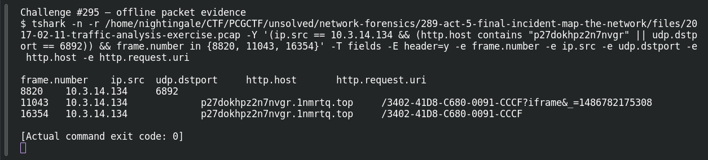

# ACT 5 — Final Incident: Second Ransomware

**Platform:** PCGCTF · **Challenge ID:** 295 · **Category:** Network Forensics · **Points:** 100

**Status:** Answer backed by the Act 5 capture. Exact PCGCTF submission not independently re-confirmed.

## The challenge

Attribute the ransomware on 10.3.14.134.

## Solving it

This host shows the classic Cerber pair — a UDP spray to port 6892 and a `.top` ransom-portal URL with a hex victim ID:

```sh
tshark -nr act5.pcap -Y 'ip.src==10.3.14.134 && (udp.dstport==6892 || http.request)' \
  -T fields -e udp.dstport -e http.host -e http.request.uri
```

```text
6892   —                          —
—      p27dokhpz2n7nvgr.1nmrtq.top /3402-41D8-C680-0091-CCCF
```

The UDP 6892 beacon plus the `*.top` onion-style portal are Cerber hallmarks.

## Screenshot



## Flag

```text
pcgCTF{Cerber}
```

## Takeaway

Cerber's fingerprint is the large UDP spray (port 6892 here) alongside an HTTP portal keyed by a per-victim ID — two IOCs, one family.

## Reference

- [Original challenge description](../../solved/network-forensics/295-act-5-final-incident-second-ransomware/README.md)
