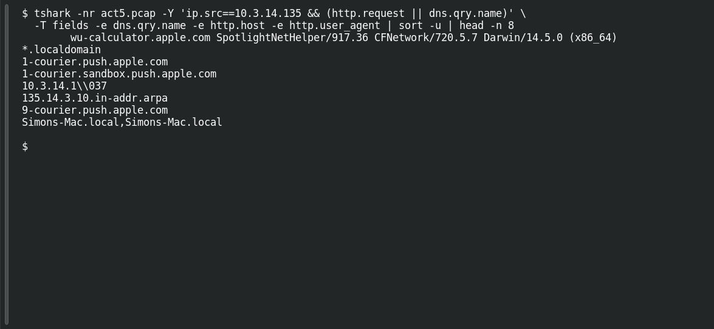

# ACT 5 — Final Incident: Final Assessment

**Platform:** PCGCTF · **Challenge ID:** 296 · **Category:** Network Forensics · **Points:** 100

**Status:** Answer backed by the Act 5 capture. Exact PCGCTF submission not independently re-confirmed.

## The challenge

Which client shows neither ransomware pattern?

## Solving it

Use [the shared capture](../../unsolved/network-forensics/289-act-5-final-incident-map-the-network/files/2017-02-11-traffic-analysis-exercise.pcap) as `act5.pcap` for the commands below.

The saved analysis found neither of the two ransomware patterns in `10.3.14.135`'s traffic. Its DNS and HTTP records include Apple services and Reddit. Selected rows are shown below:

```sh
tshark -nr act5.pcap -Y 'ip.src==10.3.14.135 && (http.request || dns.qry.name)' \
  -T fields -e dns.qry.name -e http.host -e http.user_agent | sort -u | head -n 8
```

```text
wu-calculator.apple.com	SpotlightNetHelper/917.36 CFNetwork/720.5.7 Darwin/14.5.0 (x86_64)
*.localdomain
1-courier.push.apple.com
1-courier.sandbox.push.apple.com
10.3.14.1\\037
135.14.3.10.in-addr.arpa
9-courier.push.apple.com
Simons-Mac.local,Simons-Mac.local
```

For this question, `10.3.14.135` is the client with no observed Spora or Cerber indicators. That conclusion is limited to the supplied capture.

## Screenshot

Fresh local reproduction using the command described above.



## Flag

```text
pcgCTF{10.3.14.135}
```

## Takeaway

The absence of these indicators answers the exercise question; it does not establish that the endpoint was free of all malware.

## Reference

- [Original challenge description](../../unsolved/network-forensics/296-act-5-final-incident-final-assessment/README.md)
- [Saved indicator counts](../evidence/network/act5-indicator-source-counts.json)
