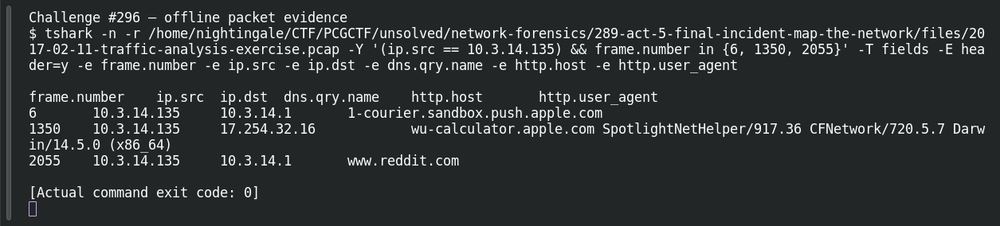

# ACT 5 - FINAL INCIDENT: Final Assessment

| Item | Record |
|---|---|
| Platform | PCGCTF |
| Challenge ID | 296 |
| Category | Network Forensics |
| Points | 250 |
| Difficulty | Not separately recorded in the available inventory |
| Verification | Needs Flag Verification — the answer has offline evidence, but our PCGCTF snapshot does not record acceptance. A teammate’s reported acceptance, where noted, is separate evidence. |

## Challenge and objective

Identify the client lacking the two ransomware patterns observed in this capture.

The original description and prerequisite chain are preserved in [the challenge README](../../unsolved/network-forensics/296-act-5-final-incident-final-assessment/README.md). The supplied evidence is `2017-02-11-traffic-analysis-exercise.pcap`; related storyline questions reuse the same capture rather than providing another download.

## Initial analysis

The question’s clean label needs a careful scope. I compared the same observed signatures across the three known clients instead of claiming that a few ordinary packets prove a machine universally safe.

I kept the original capture intact and used offline packet analysis. The file’s SHA-256 is `6971ca45f782265b10378d8331201b14704cd8525922fd89bb909fef3e788075`. This identifies the exact evidence behind the frame references; no reconstructed program was executed and no request was sent to an address found inside the capture.

## Step-by-step solution

### 1. Narrow the incident to a reproducible evidence set

The discovery filter for this question is:

```wireshark
ip.src == 10.3.14.135
```

In Wireshark, the filter removes unrelated frames from the display without deleting them from the file. For a command-line reproduction, the following extraction additionally selects the cited frames where appropriate:

```sh
tshark -n \
  -r /home/nightingale/CTF/PCGCTF/unsolved/network-forensics/289-act-5-final-incident-map-the-network/files/2017-02-11-traffic-analysis-exercise.pcap \
  -Y '(ip.src == 10.3.14.135) && frame.number in {6, 1350, 2055}' \
  -T fields -E header=y -e frame.number -e ip.src -e ip.dst -e dns.qry.name -e http.host -e http.user_agent
```

`-n` disables address/name resolution so that recorded numeric addresses stay visible. `-r` reads the existing capture, and `-Y` applies a display filter after decoding. `-T fields` outputs selected fields; each `-e` adds one named column, and `-E header=y` records the column names. The `frame.number in {...}` clause makes the final evidence small and auditable; the wider discovery filter remains documented above.

**Actual reproduced output** (tab-separated; full lines are preserved in the linked TSV):

```text
frame.number	ip.src	ip.dst	dns.qry.name	http.host	http.user_agent
6	10.3.14.135	10.3.14.1	1-courier.sandbox.push.apple.com		
1350	10.3.14.135	17.254.32.16		wu-calculator.apple.com	SpotlightNetHelper/917.36 CFNetwork/720.5.7 Darwin/14.5.0 (x86_64)
2055	10.3.14.135	10.3.14.1	www.reddit.com
```

### 2. Interpret the result

10.3.14.135 shows Apple services and normal browsing in the preserved examples. A fresh filter for the Spora host, the Cerber host prefix and UDP/6892 returns sources .131 and .134 only. Thus .135 is the non-infected answer under this exercise’s evidence, while unobserved or unrelated malware cannot be ruled out from this comparison alone.

### Compare the three clients consistently

A fresh offline search used this same indicator set for every source:

```wireshark
http.host == "spora.biz" || http.host contains "p27dokhpz2n7nvgr" || udp.dstport == 6892
```

Actual source-count summary:

```text
{
  "10.3.14.134": 2204,
  "10.3.14.131": 7
}
```

These are counts of matching packets, not numbers of victims or proof of unique infections. No packet from `10.3.14.135` matched this indicator set. The conclusion is limited to those signatures and this capture, rather than all possible compromise. [Saved count record](../evidence/network/act5-indicator-source-counts.json).

## Captured screenshots and evidence

Captured on 2026-10-29 from actual terminal sessions or browser views. Captions distinguish new results, preserved records, source images and blockers. No platform acceptance is inferred from these images.

### Challenge #296 — offline packet evidence



Fresh execution of the draft’s field-specific TShark command.

Command/action actually executed:

```sh
tshark -n -r /home/nightingale/CTF/PCGCTF/unsolved/network-forensics/289-act-5-final-incident-map-the-network/files/2017-02-11-traffic-analysis-exercise.pcap -Y '(ip.src == 10.3.14.135) && frame.number in {6, 1350, 2055}' -T fields -E header=y -e frame.number -e ip.src -e ip.dst -e dns.qry.name -e http.host -e http.user_agent
```

[Actual command transcript](../screenshots/capture-work/296-network.terminal.log) · [Execution record](../screenshots/capture-work/296-network.result.json). Notice the result fields discussed in the corresponding solution step; the transcript retains lines that extend beyond the screenshot viewport.

## Flag discovery and verification

Saved submission candidate:

```text
pcgCTF{10.3.14.135}
```

Needs Flag Verification — the answer has offline evidence, but our PCGCTF snapshot does not record acceptance. A teammate’s reported acceptance, where noted, is separate evidence. The exact wrapper comes from the challenge’s `pcgCTF{...}` requirement; literal spaces, capitalization and separators are retained as recorded. The focused final check is to submit this exact saved spelling when the platform is available and preserve the resulting acceptance or rejection with the challenge ID.

## Conclusion and lesson

Negative findings must name the searched indicators and observation boundary. No observed infection is not a forensic guarantee of a clean endpoint. The artifact-backed answer and the platform acceptance state remain separate in this draft.

## Reproduction evidence and references

- [Original challenge description](../../unsolved/network-forensics/296-act-5-final-incident-final-assessment/README.md)
- [Actual TShark field output](../evidence/network/296-fields.tsv)
- [Commands, hashes and reproduction results](../evidence/network/reproduction.json)
- [TShark version](../evidence/network/tshark-version.txt)
- [TShark official manual](https://www.wireshark.org/docs/man-pages/tshark.html)

- [Earlier local solution and provenance](../../unsolved/network-forensics/296-act-5-final-incident-final-assessment/solution.md)
