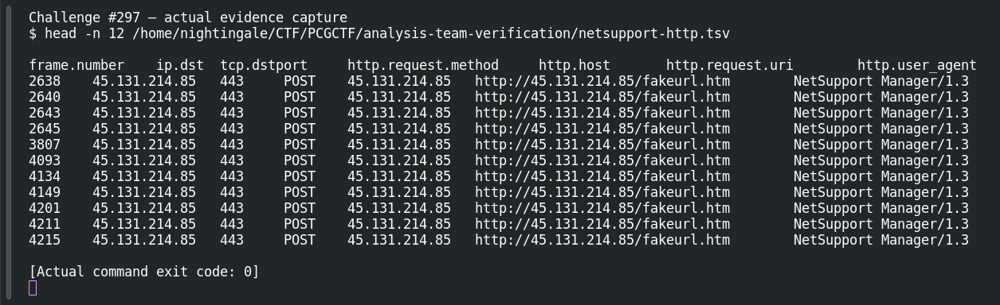

# ACT 1 - EASY AS 123: Threat Identity

| Field | Details |
|---|---|
| Platform | PCGCTF |
| Challenge ID | 297 |
| Technical category | OSINT |
| Points in saved inventory | 100 |
| Difficulty | Not stated in the saved challenge description |
| Objective | Identify the RAT family associated with the external IOC. |
| Result | `pcgCTF{NetSupport Manager RAT}` |

**Needs Flag Verification:** the answer is supported by the evidence described below, but its exact submission has not been confirmed accepted by PCGCTF.

## Reading the clues

An IP address can host multiple services over time. I tied it to the named incident before choosing a family; an unrelated current reputation label would be weaker than an incident-specific report.

## Working through the evidence

### 1. Bind the lookup to the supplied indicator

The starting indicator is `45.131.214.85`. Read the original question linked below first: it determines whether the answer is a family, domain, port, organization or year. These are different pivots even when they share a capture.

### 2. Check the source and preserve the decisive record

The original Easy As123 exercise names NetSupport Manager RAT for this exact IP and TCP 443. ThreatFox IOC1755776 independently gives NetSupportManager RAT, alias NetSupport, and connects the same sample hash. The local capture corroborates the family-specific User-Agent rather than serving as the sole public attribution.

The observed source/record is preserved below. These are recorded verification results; the drafting pass does not claim a fresh successful website query or a new grader submission.

```sh
tshark -n -r /home/nightingale/CTF/PCGCTF/solved/network-forensics/268-act-2-the-compromise-infected-ipv4/files/2026-02-28-traffic-analysis-exercise.pcap -d tcp.port==443,http -Y 'ip.dst==45.131.214.85 && http.request' -T fields -e frame.number -e ip.dst -e tcp.dstport -e http.user_agent
```

This offline reproduction uses `-r` to read the original capture, `-n` to suppress network name resolution, `-Y` for a display filter, and `-T fields` plus each `-e` to select the displayed packet fields. The filter binds the answer to the supplied IOC. Where present, `-d tcp.port==443,http` tells the dissector to interpret that stream as HTTP; it is a decoding choice, not a change to the stored traffic.

Recorded evidence excerpt (first lines, not a newly fabricated command response):

```text
frame.number	ip.dst	tcp.dstport	http.request.method	http.host	http.request.uri	http.user_agent
2638	45.131.214.85	443	POST	45.131.214.85	http://45.131.214.85/fakeurl.htm	NetSupport Manager/1.3
```

### 3. Interpret the result at the requested level

NetSupport is legitimate remote-management software that can be abused as a RAT. The answer identifies the reported family, not the organization operating the IP. The candidate below wraps the recorded answer using the format specified by this challenge; the supporting evidence does not itself prove platform acceptance.

Source: [https://www.malware-traffic-analysis.net/2026/02/28/index.html](https://www.malware-traffic-analysis.net/2026/02/28/index.html).

## Captured screenshots and evidence

Captured on 2026-10-29 from actual terminal sessions or browser views. Captions distinguish new results, preserved records, source images and blockers. No platform acceptance is inferred from these images.

### Challenge #297 — actual evidence capture



Actual terminal inspection of preserved verification record, explicitly historical rather than a new external lookup. This reads preserved evidence; it is not a fresh external IOC lookup.

Command/action actually executed:

```sh
head -n 12 /home/nightingale/CTF/PCGCTF/analysis-team-verification/netsupport-http.tsv
```

[Actual command transcript](../screenshots/capture-work/297-saved-record.terminal.log) · [Execution record](../screenshots/capture-work/297-saved-record.result.json). Notice the result fields discussed in the corresponding solution step; the transcript retains lines that extend beyond the screenshot viewport.

## Flag discovery and final verification

The saved submission candidate is **`pcgCTF{NetSupport Manager RAT}`**. NetSupport is legitimate remote-management software that can be abused as a RAT. The answer identifies the reported family, not the organization operating the IP. Exact PCGCTF acceptance is not recorded.

The remaining platform check is to open the specific PCGCTF challenge, copy the documented payload with its exact capitalization, spaces and punctuation, and capture the real acceptance or rejection response. No successful submission is inferred from the existence of the answer. If rejected, record the response and compare the stated format before changing the evidence-backed payload.

## What this challenge taught me

NetSupport is legitimate remote-management software that can be abused as a RAT. The answer identifies the reported family, not the organization operating the IP.

## Evidence and references

[Original archived challenge](../../unsolved/osint/297-act-1-easy-as-123-threat-identity/README.md)

- [Decisive saved lookup / packet evidence](../../analysis-team-verification/netsupport-http.tsv)
- [Original capture identities and extraction filters](../../analysis-team-verification/packet-checks.json)
- [Preserved investigation notes](../../unsolved/osint/297-act-1-easy-as-123-threat-identity/solution.md)

**Provenance:** Rewritten from our independently checked original-capture/primary-source verification ledger; raw records linked and acceptance explicitly separated.
