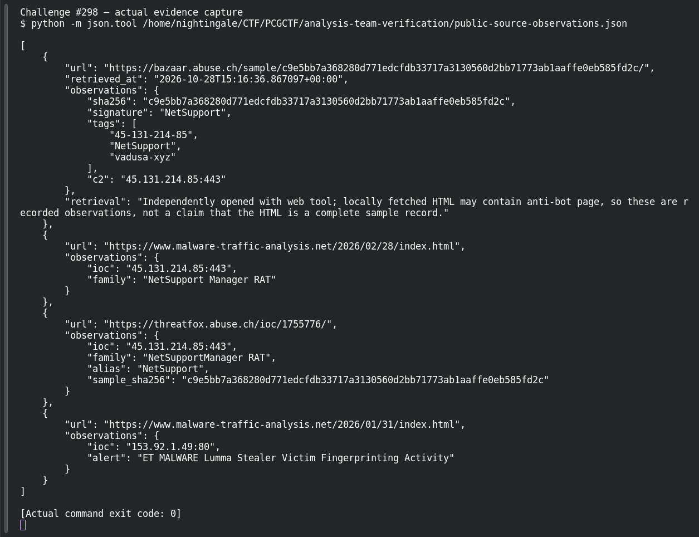

# ACT 1 - EASY AS 123: Domain Pivot

| Field | Details |
|---|---|
| Platform | PCGCTF |
| Challenge ID | 298 |
| Technical category | OSINT |
| Points in saved inventory | 100 |
| Difficulty | Not stated in the saved challenge description |
| Objective | Find the historically associated C2 domain. |
| Result | `pcgCTF{vadusa.xyz}` |

**Needs Flag Verification:** the answer is supported by the evidence described below, but its exact submission has not been confirmed accepted by PCGCTF.

## Reading the clues

Historical associations matter because current DNS may change. I looked for an explicit IP/domain relationship, not a domain that happened to share hosting.

## Working through the evidence

### 1. Bind the lookup to the supplied indicator

The starting indicator is `45.131.214.85`. Read the original question linked below first: it determines whether the answer is a family, domain, port, organization or year. These are different pivots even when they share a capture.

### 2. Check the source and preserve the decisive record

The exact MalwareBazaar sample entry carries both 45-131-214-85 and vadusa-xyz tags, identifies NetSupport and lists the C2 IP:port. The firsthand analyst report for the same exercise explicitly associates vadusa.xyz with the IP. Together these support the refanged domain vadusa.xyz.

The observed source/record is preserved below. These are recorded verification results; the drafting pass does not claim a fresh successful website query or a new grader submission.

Open the linked primary/reference page for the exact indicator, retain its URL, and read the field described above. This step is browser-based: no malware execution, domain visitation or invented terminal output is necessary. The saved JSON observations distinguish what the page actually stated from a later interpretation.

### 3. Interpret the result at the requested level

The dash-separated database tag is a normalized indicator label; the explicit domain in the matching analyst report resolves its punctuation. This is a historical relationship, not a claim about current ownership. The candidate below wraps the recorded answer using the format specified by this challenge; the supporting evidence does not itself prove platform acceptance.

Source: [https://rvmchua.com/posts/mta-easy-as-123/](https://rvmchua.com/posts/mta-easy-as-123/).

## Captured screenshots and evidence

Captured on 2026-10-29 from actual terminal sessions or browser views. Captions distinguish new results, preserved records, source images and blockers. No platform acceptance is inferred from these images.

### Challenge #298 — actual evidence capture



Actual terminal inspection of preserved verification record, explicitly historical rather than a new external lookup. This reads preserved evidence; it is not a fresh external IOC lookup.

Command/action actually executed:

```sh
python -m json.tool /home/nightingale/CTF/PCGCTF/analysis-team-verification/public-source-observations.json
```

[Actual command transcript](../screenshots/capture-work/298-saved-record.terminal.log) · [Execution record](../screenshots/capture-work/298-saved-record.result.json). Notice the result fields discussed in the corresponding solution step; the transcript retains lines that extend beyond the screenshot viewport.

## Flag discovery and final verification

The saved submission candidate is **`pcgCTF{vadusa.xyz}`**. The dash-separated database tag is a normalized indicator label; the explicit domain in the matching analyst report resolves its punctuation. This is a historical relationship, not a claim about current ownership. Exact PCGCTF acceptance is not recorded.

The remaining platform check is to open the specific PCGCTF challenge, copy the documented payload with its exact capitalization, spaces and punctuation, and capture the real acceptance or rejection response. No successful submission is inferred from the existence of the answer. If rejected, record the response and compare the stated format before changing the evidence-backed payload.

## What this challenge taught me

The dash-separated database tag is a normalized indicator label; the explicit domain in the matching analyst report resolves its punctuation. This is a historical relationship, not a claim about current ownership.

## Evidence and references

[Original archived challenge](../../unsolved/osint/298-act-1-easy-as-123-domain-pivot/README.md)

- [Decisive saved lookup / packet evidence](../../analysis-team-verification/public-source-observations.json)
- [Original capture identities and extraction filters](../../analysis-team-verification/packet-checks.json)
- [Preserved investigation notes](../../unsolved/osint/298-act-1-easy-as-123-domain-pivot/solution.md)

**Provenance:** Rewritten from our independently checked original-capture/primary-source verification ledger; raw records linked and acceptance explicitly separated.
