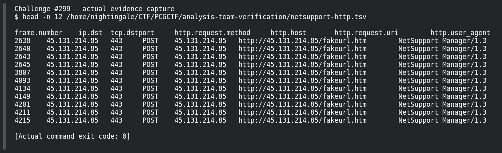

# ACT 1 - EASY AS 123: Protocol Deception

| Field | Details |
|---|---|
| Platform | PCGCTF |
| Challenge ID | 299 |
| Technical category | OSINT |
| Points in saved inventory | 100 |
| Difficulty | Not stated in the saved challenge description |
| Objective | Identify the cleartext application protocol on the HTTPS-numbered port. |
| Result | `pcgCTF{HTTP}` |

**Needs Flag Verification:** the answer is supported by the evidence described below, but its exact submission has not been confirmed accepted by PCGCTF.

## Reading the clues

A port is a convention, not a protocol decoder. Readable request lines and headers can establish HTTP even when a stream uses443.

## Working through the evidence

### 1. Bind the lookup to the supplied indicator

The starting indicator is `45.131.214.85:443`. Read the original question linked below first: it determines whether the answer is a family, domain, port, organization or year. These are different pivots even when they share a capture.

### 2. Check the source and preserve the decisive record

The independent packet check decoded264 HTTP requests. Frame 2638 is a POST to http://45.131.214.85/fakeurl.htm with User-Agent NetSupport Manager/1.3. The request and form data are readable without TLS decryption. The firsthand public analysis agrees that the traffic is plain HTTP.

The observed source/record is preserved below. These are recorded verification results; the drafting pass does not claim a fresh successful website query or a new grader submission.

```sh
tshark -n -r /home/nightingale/CTF/PCGCTF/solved/network-forensics/268-act-2-the-compromise-infected-ipv4/files/2026-02-28-traffic-analysis-exercise.pcap -d tcp.port==443,http -Y 'ip.dst==45.131.214.85 && http.request' -T fields -e frame.number -e tcp.dstport -e http.request.method -e http.request.uri -e http.user_agent
```

This offline reproduction uses `-r` to read the original capture, `-n` to suppress network name resolution, `-Y` for a display filter, and `-T fields` plus each `-e` to select the displayed packet fields. The filter binds the answer to the supplied IOC. Where present, `-d tcp.port==443,http` tells the dissector to interpret that stream as HTTP; it is a decoding choice, not a change to the stored traffic.

Recorded evidence excerpt (first lines, not a newly fabricated command response):

```text
frame.number	ip.dst	tcp.dstport	http.request.method	http.host	http.request.uri	http.user_agent
2638	45.131.214.85	443	POST	45.131.214.85	http://45.131.214.85/fakeurl.htm	NetSupport Manager/1.3
```

### 3. Interpret the result at the requested level

Decode-as is a viewing instruction to TShark, not an alteration of the capture. The readable syntax validates that choice. Do not infer TLS solely from443. The candidate below wraps the recorded answer using the format specified by this challenge; the supporting evidence does not itself prove platform acceptance.

Source: [https://rvmchua.com/posts/mta-easy-as-123/](https://rvmchua.com/posts/mta-easy-as-123/).

## Captured screenshots and evidence

Captured on 2026-10-29 from actual terminal sessions or browser views. Captions distinguish new results, preserved records, source images and blockers. No platform acceptance is inferred from these images.

### Challenge #299 — actual evidence capture



Actual terminal inspection of preserved verification record, explicitly historical rather than a new external lookup. This reads preserved evidence; it is not a fresh external IOC lookup.

Command/action actually executed:

```sh
head -n 12 /home/nightingale/CTF/PCGCTF/analysis-team-verification/netsupport-http.tsv
```

[Actual command transcript](../screenshots/capture-work/299-saved-record.terminal.log) · [Execution record](../screenshots/capture-work/299-saved-record.result.json). Notice the result fields discussed in the corresponding solution step; the transcript retains lines that extend beyond the screenshot viewport.

## Flag discovery and final verification

The saved submission candidate is **`pcgCTF{HTTP}`**. Decode-as is a viewing instruction to TShark, not an alteration of the capture. The readable syntax validates that choice. Do not infer TLS solely from443. Exact PCGCTF acceptance is not recorded.

The remaining platform check is to open the specific PCGCTF challenge, copy the documented payload with its exact capitalization, spaces and punctuation, and capture the real acceptance or rejection response. No successful submission is inferred from the existence of the answer. If rejected, record the response and compare the stated format before changing the evidence-backed payload.

## What this challenge taught me

Decode-as is a viewing instruction to TShark, not an alteration of the capture. The readable syntax validates that choice. Do not infer TLS solely from443.

## Evidence and references

[Original archived challenge](../../unsolved/osint/299-act-1-easy-as-123-protocol-deception/README.md)

- [Decisive saved lookup / packet evidence](../../analysis-team-verification/netsupport-http.tsv)
- [Original capture identities and extraction filters](../../analysis-team-verification/packet-checks.json)
- [Preserved investigation notes](../../unsolved/osint/299-act-1-easy-as-123-protocol-deception/solution.md)

**Provenance:** Rewritten from our independently checked original-capture/primary-source verification ledger; raw records linked and acceptance explicitly separated.
