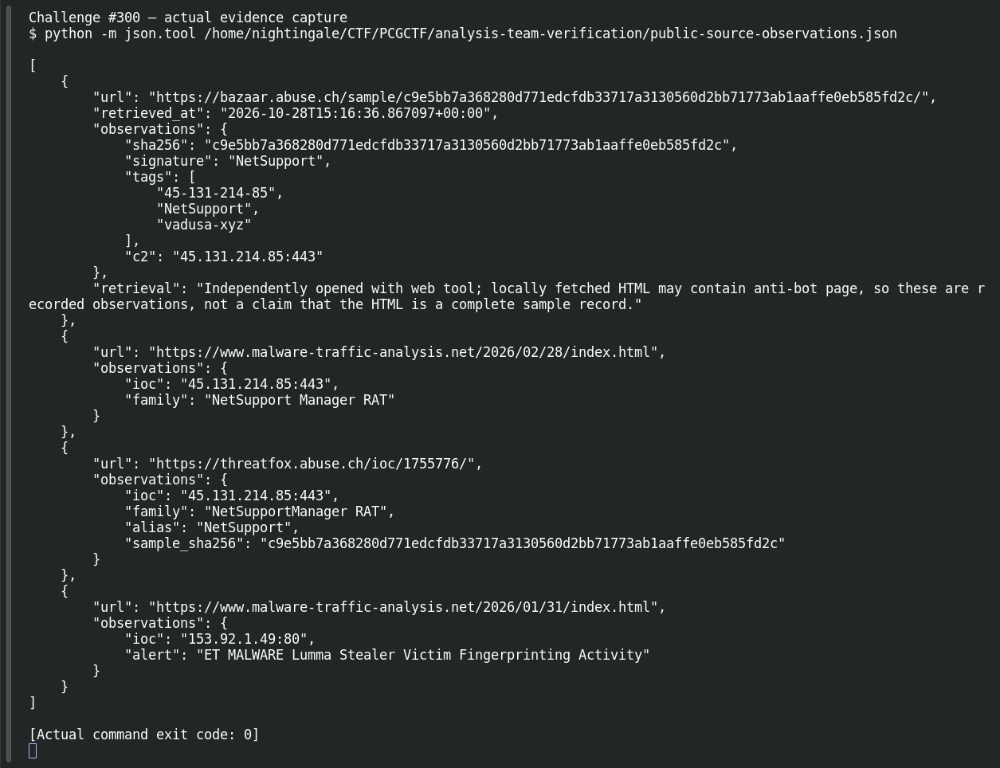

# ACT 1 — Easy as 123: Malware Hash Pivot

**Platform:** PCGCTF · **Challenge ID:** 300 · **Category:** Network Forensics / OSINT · **Points:** 100

**Status:** Answer backed by cited public sources. Exact PCGCTF submission not re-confirmed.

## The challenge

Pivot from a sample's SHA-256 to its family tag.

Indicator: `c9e5bb7a368280d771edcfdb33717a3130560d2bb71773ab1aaffe0eb585fd2c`

## Solving it

A full SHA-256 pins the lookup to one exact file, so there's no ambiguity. The MalwareBazaar entry for that digest has signature `NetSupport`, and ThreatFox ties the same sample to the NetSupport Manager RAT C2:

```text
MalwareBazaar c9e5bb7a... → Signature: NetSupport
```

The family tag is `NetSupport`. (No sample was downloaded or run — this is a database lookup.)

## Screenshot



## Flag

```text
pcgCTF{NetSupport}
```

## Takeaway

Pivot on the full hash, not a filename or a generic "malicious" verdict — those answer different questions. Mind which spelling the question wants (`NetSupport` the tag vs. the fuller "NetSupport Manager RAT" from #297).

## References

- [MalwareBazaar sample](https://bazaar.abuse.ch/sample/c9e5bb7a368280d771edcfdb33717a3130560d2bb71773ab1aaffe0eb585fd2c/)
- [Original challenge description](../../solved/network-forensics/300-act-1-easy-as-123-malware-hash-pivot/README.md)
