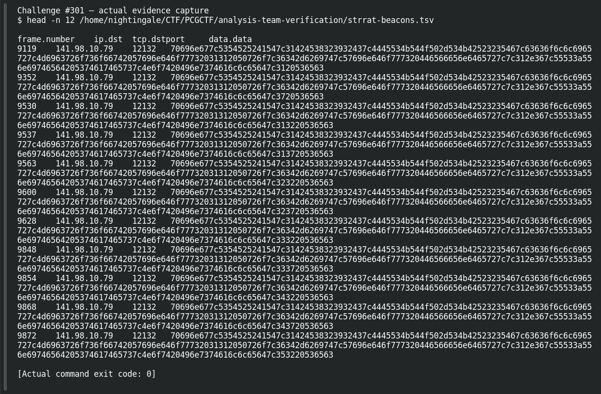

# ACT 2 — You Dirty RAT!: Identify the RAT

**Platform:** PCGCTF · **Challenge ID:** 301 · **Category:** Network Forensics · **Points:** 100

**Status:** Answer backed by the capture and cited public sources. Exact PCGCTF submission not re-confirmed.

## The challenge

Name the RAT family beaconing to `141.98.10.79`.

## Solving it

The capture has ~102 outbound packets containing the string `STRRAT`, and the beacon names itself in cleartext:

```sh
tshark -nr act.pcap -Y 'ip.dst==141.98.10.79 && tcp contains "STRRAT"' \
  -T fields -e tcp.dstport -e data.data | head -1 | cut -f2 | xxd -r -p
```

```text
ping|STRRAT|1BE8292C|DESKTOP-SKBR25F|ccollier|...
```

`ping|STRRAT|...` — the family is STRRAT, matching the public analysis of this exercise.

## Screenshot



## Flag

```text
pcgCTF{STRRAT}
```

## Takeaway

STRRAT's beacon names the family in plaintext; the host/account fields that follow are corroboration, not a reason to invent a different label.

## References

- [Malware-traffic-analysis: 2024-07-30](https://www.malware-traffic-analysis.net/2024/07/30/index.html)
- [Original challenge description](../../solved/network-forensics/301-act-2-you-dirty-rat-identify-the-rat/README.md)
