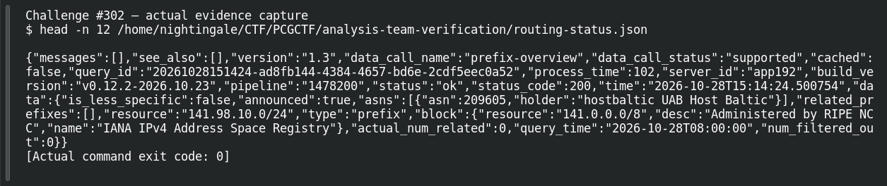

# ACT 2 — You Dirty RAT!: Infrastructure Owner

**Platform:** PCGCTF · **Challenge ID:** 302 · **Category:** OSINT · **Points:** 100

**Status:** Answer backed by cited public sources (time-sensitive). Exact PCGCTF submission not re-confirmed.

## The challenge

Who announces the network holding the C2 (`141.98.10.0/24`)?

## Solving it

Registration, route origin, and the hosted customer are three different facts — the question wants the announcing operator, so I followed the route-origin ASN rather than reverse-DNS branding:

```sh
curl -sS "https://stat.ripe.net/data/prefix-overview/data.json?resource=141.98.10.0/24"
```

```text
announced: true
origin ASN: AS209605
holder: hostbaltic UAB Host Baltic
```

RIPE's route object (origin AS209605, aut-num `hostbaltic`) and IPinfo agree. The announcing organisation is `UAB Host Baltic`.

## Screenshot



## Flag

```text
pcgCTF{UAB Host Baltic}
```

## Takeaway

For "who owns this network," trust the BGP route origin / aut-num, not a reverse hostname. And note the answer is time-sensitive — preserve the raw query response.

## References

- [RIPEstat prefix overview](https://stat.ripe.net/data/prefix-overview/data.json?resource=141.98.10.0/24)
- [Original challenge description](../../solved/network-forensics/302-act-2-you-dirty-rat-infrastructure-owner/README.md)
