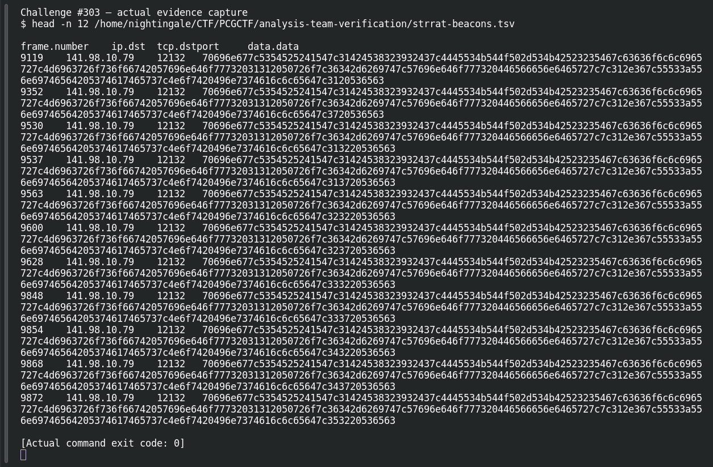

# ACT 2 — You Dirty RAT!: C2 Service Port

**Platform:** PCGCTF · **Challenge ID:** 303 · **Category:** Network Forensics · **Points:** 100

**Status:** Answer backed by the capture and cited public sources. Exact PCGCTF submission not re-confirmed.

## The challenge

What TCP port does the STRRAT C2 listen on?

## Solving it

I restricted to the known C2 IP and the STRRAT marker, then read the *destination* port (not the client's ephemeral source port):

```sh
tshark -nr act.pcap -Y 'ip.dst==141.98.10.79 && tcp contains "STRRAT"' \
  -T fields -e tcp.dstport | sort -u
```

```text
12132
```

All ~102 beacon packets go to TCP 12132.

## Screenshot



## Flag

```text
pcgCTF{12132}
```

## Takeaway

Read the destination port, and keep the IOC attached — STRRAT's port is per-config (12132 here), not a fixed default.

## References

- [STRRAT traffic analysis](https://securityposture.medium.com/traffic-analysis-of-strrat-malware-6b9c212c6ae6)
- [Original challenge description](../../solved/network-forensics/303-act-2-you-dirty-rat-c2-service-port/README.md)
