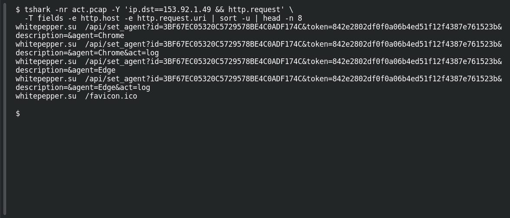

# ACT 3 — Lumma in the Room-ah!: Identify the Stealer

**Platform:** PCGCTF · **Challenge ID:** 304 · **Category:** Network Forensics · **Points:** 100

**Status:** Answer backed by the capture and cited public sources. Exact PCGCTF submission not re-confirmed.

## The challenge

Name the info-stealer talking to `153.92.1.49`.

## Solving it

Use [the shared capture](../../unsolved/network-forensics/282-act-4-lumma-in-the-room-lumma-victim/files/2026-01-31-traffic-analysis-exercise.pcap) as `act.pcap`.

The title hints "Lumma," but a title isn't attribution — so I leaned on the IDS signature and the request shape. The public exercise flags `ET MALWARE Lumma Stealer Victim Fingerprinting Activity` on this IP, and the capture matches it:

```sh
tshark -nr act.pcap -Y 'ip.dst==153.92.1.49 && http.request' \
  -T fields -e http.host -e http.request.uri | sort -u | head -n 8
```

```text
whitepepper.su	/api/set_agent?id=3BF67EC05320C5729578BE4C0ADF174C&token=842e2802df0f0a06b4ed51f12f4387e761523b&description=&agent=Chrome
whitepepper.su	/api/set_agent?id=3BF67EC05320C5729578BE4C0ADF174C&token=842e2802df0f0a06b4ed51f12f4387e761523b&description=&agent=Chrome&act=log
whitepepper.su	/api/set_agent?id=3BF67EC05320C5729578BE4C0ADF174C&token=842e2802df0f0a06b4ed51f12f4387e761523b&description=&agent=Edge
whitepepper.su	/api/set_agent?id=3BF67EC05320C5729578BE4C0ADF174C&token=842e2802df0f0a06b4ed51f12f4387e761523b&description=&agent=Edge&act=log
whitepepper.su	/favicon.ico
```

The `/api/set_agent` victim-fingerprinting request to `whitepepper.su` is Lumma Stealer's behaviour.

## Screenshot

Fresh local reproduction using the command described above.



## Flag

```text
pcgCTF{Lumma Stealer}
```

## Takeaway

Treat the challenge title as a lead, not proof — confirm with the signature plus the characteristic `set_agent` request.

## References

- [Malware-traffic-analysis: 2026-01-31](https://www.malware-traffic-analysis.net/2026/01/31/index.html)
- [Original challenge description](../../unsolved/osint/304-act-3-lumma-in-the-room-ah-identify-the-stealer/README.md)
