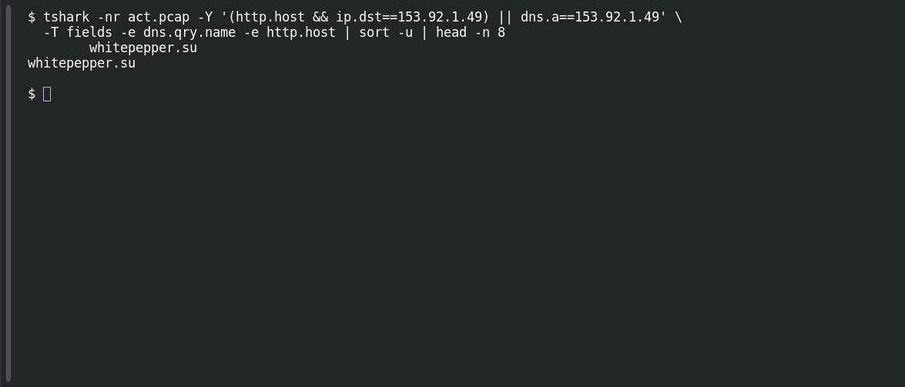

# ACT 3 — Lumma in the Room-ah!: Domain Pivot

**Platform:** PCGCTF · **Challenge ID:** 305 · **Category:** Network Forensics · **Points:** 100

**Status:** Answer backed by the capture. Exact PCGCTF submission not re-confirmed.

**Evidence:** Packets 23723, 24500 · TCP stream 99 · UDP stream 99 · [2026-01-31-traffic-analysis-exercise.pcap](../../unsolved/network-forensics/282-act-4-lumma-in-the-room-lumma-victim/files/2026-01-31-traffic-analysis-exercise.pcap).

## The challenge

Pivot from the Lumma C2 IP (`153.92.1.49`) to its domain.

## Solving it

Use [the shared capture](../../unsolved/network-forensics/282-act-4-lumma-in-the-room-lumma-victim/files/2026-01-31-traffic-analysis-exercise.pcap) as `act.pcap`.

I used the HTTP Host on the actual C2 requests (the virtual host the request targets), confirmed by the DNS answer that resolved it there:

```sh
tshark -nr act.pcap -Y '(http.host && ip.dst==153.92.1.49) || dns.a==153.92.1.49' \
  -T fields -e dns.qry.name -e http.host | sort -u | head -n 8
```

```text
whitepepper.su
whitepepper.su
```

The domain is `whitepepper.su`.

## Screenshot

Fresh local reproduction using the command described above.



## Flag

```text
pcgCTF{whitepepper.su}
```

## Takeaway

The HTTP Host on the C2 request is more useful than every name ever hosted at that IP — and the DNS answer confirms it's the right one.

## Reference

- [Original challenge description](../../unsolved/osint/305-act-3-lumma-in-the-room-ah-domain-pivot/README.md)
