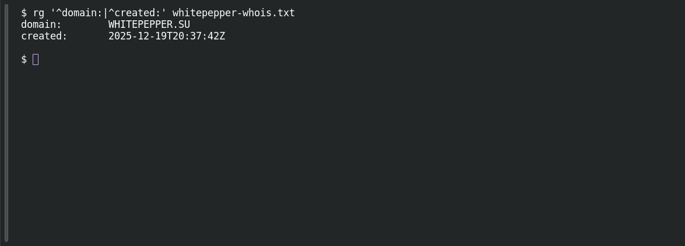

# ACT 3 — Lumma in the Room-ah!: Registration OSINT

**Platform:** PCGCTF · **Challenge ID:** 306 · **Category:** OSINT · **Points:** 100

**Status:** Answer backed by cited WHOIS records (time-sensitive). Exact PCGCTF submission not re-confirmed.

## The challenge

What year was the C2 domain `whitepepper.su` registered?

## Solving it

The saved WHOIS response records the creation date. The following command shows how to retrieve that field; the response beneath it comes from the archived lookup:

```sh
whois whitepepper.su | grep -i 'created\|registered'
```

```text
created:       2025-12-19T20:37:42Z
```

The recorded registration year is 2025. The archived response was last updated on 28 October 2026.

## Screenshot

Local inspection of the archived lookup response; this is not a new external lookup.



## Flag

```text
pcgCTF{2025}
```

## Takeaway

A recent registration date is itself an IOC — throwaway C2 domains are usually registered right before the campaign. WHOIS data is time-sensitive, so preserve the raw record.

## Reference

- [Original challenge description](../../unsolved/osint/306-act-3-lumma-in-the-room-ah-registration-osint/README.md)
- [Archived WHOIS response](../../analysis-team-verification/whitepepper-whois.txt)
