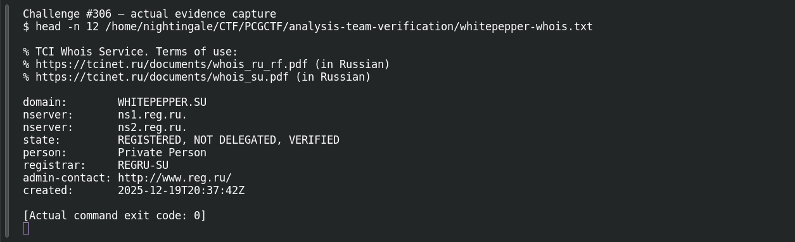

# ACT 3 - LUMMA IN THE ROOM-AH!: Registration OSINT

| Field | Details |
|---|---|
| Platform | PCGCTF |
| Challenge ID | 306 |
| Technical category | OSINT |
| Points in saved inventory | 100 |
| Difficulty | Not stated in the saved challenge description |
| Objective | Read the domain’s registration year from public WHOIS. |
| Result | `pcgCTF{2025}` |

**Needs Flag Verification:** the answer is supported by the evidence described below, but its exact submission has not been confirmed accepted by PCGCTF.

## Reading the clues

Registration dates can reset when a domain lapses and is registered again. The question gives no historical snapshot, so the current registry creation field is the observed answer; older DNS sightings are a separate timeline.

## Working through the evidence

### 1. Bind the lookup to the supplied indicator

The starting indicator is `whitepepper.su`. Read the original question linked below first: it determines whether the answer is a family, domain, port, organization or year. These are different pivots even when they share a capture.

### 2. Check the source and preserve the decisive record

The direct .su registry response from whois.tcinet.ru identifies WHITEPEPPER.SU and returns created:2025-12-19T20:37:42Z, source TCI. Taking the year from that field gives2025. Older DNS history is explicitly preserved as a caveat rather than silently equated with creation.

The observed source/record is preserved below. These are recorded verification results; the drafting pass does not claim a fresh successful website query or a new grader submission.

```sh
whois -h whois.tcinet.ru whitepepper.su
```

This is a reproduction recipe using the registry host named by `-h`. The preserved check used a direct WHOIS socket query to that same host. Read the `created` field, not paid-till or last-updated. Actual saved decisive lines:

```text
created:       2025-12-19T20:37:42Z
source:        TCI
```

### 3. Interpret the result at the requested level

The result proves the current creation record, not the first-ever registration of a name across all owners. If an organizer expects a historical year, the relevant archived record is still needed. The candidate below wraps the recorded answer using the format specified by this challenge; the supporting evidence does not itself prove platform acceptance.

Source: [https://www.whois.com/whois/whitepepper.su](https://www.whois.com/whois/whitepepper.su).

## Captured screenshots and evidence

Captured on 2026-10-29 from actual terminal sessions or browser views. Captions distinguish new results, preserved records, source images and blockers. No platform acceptance is inferred from these images.

### Challenge #306 — actual evidence capture



Actual terminal inspection of preserved verification record, explicitly historical rather than a new external lookup. This reads preserved evidence; it is not a fresh external IOC lookup.

Command/action actually executed:

```sh
head -n 12 /home/nightingale/CTF/PCGCTF/analysis-team-verification/whitepepper-whois.txt
```

[Actual command transcript](../screenshots/capture-work/306-saved-record.terminal.log) · [Execution record](../screenshots/capture-work/306-saved-record.result.json). Notice the result fields discussed in the corresponding solution step; the transcript retains lines that extend beyond the screenshot viewport.

## Flag discovery and final verification

The saved submission candidate is **`pcgCTF{2025}`**. The result proves the current creation record, not the first-ever registration of a name across all owners. If an organizer expects a historical year, the relevant archived record is still needed. Exact PCGCTF acceptance is not recorded.

The remaining platform check is to open the specific PCGCTF challenge, copy the documented payload with its exact capitalization, spaces and punctuation, and capture the real acceptance or rejection response. No successful submission is inferred from the existence of the answer. If rejected, record the response and compare the stated format before changing the evidence-backed payload.

## What this challenge taught me

The result proves the current creation record, not the first-ever registration of a name across all owners. If an organizer expects a historical year, the relevant archived record is still needed.

## Evidence and references

[Original archived challenge](../../unsolved/osint/306-act-3-lumma-in-the-room-ah-registration-osint/README.md)

- [Decisive saved lookup / packet evidence](../../analysis-team-verification/whitepepper-whois.txt)
- [Original capture identities and extraction filters](../../analysis-team-verification/packet-checks.json)
- [Preserved investigation notes](../../unsolved/osint/306-act-3-lumma-in-the-room-ah-registration-osint/solution.md)

**Provenance:** Rewritten from our independently checked original-capture/primary-source verification ledger; raw records linked and acceptance explicitly separated.
