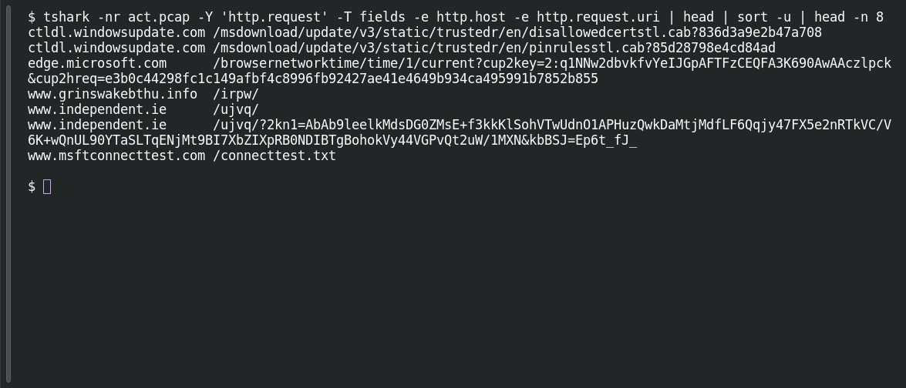

# ACT 4 — First to Last: Malware Attribution

**Platform:** PCGCTF · **Challenge ID:** 307 · **Category:** Network Forensics · **Points:** 100

**Status:** Answer backed by the capture and cited public sources. Exact PCGCTF submission not re-confirmed.

## The challenge

Attribute the malware family in the First-to-Last incident.

## Solving it

Use [the shared capture](../../solved/network-forensics/262-act-1-first-signal-patient-zero/files/ACT12026-08-09-traffic-analysis-exercise.pcap) as `act.pcap`.

The beacon pattern is the giveaway — repeated requests to randomized `.info` hosts with a short `/xxxx/` path and long encoded query parameters, which is FormBook's HTTP C2 shape:

```sh
tshark -nr act.pcap -Y 'http.request' -T fields -e http.host -e http.request.uri | head | sort -u | head -n 8
```

```text
ctldl.windowsupdate.com	/msdownload/update/v3/static/trustedr/en/disallowedcertstl.cab?836d3a9e2b47a708
ctldl.windowsupdate.com	/msdownload/update/v3/static/trustedr/en/pinrulesstl.cab?85d28798e4cd84ad
edge.microsoft.com	/browsernetworktime/time/1/current?cup2key=2:q1NNw2dbvkfvYeIJGpAFTFzCEQFA3K690AwAAczlpck&cup2hreq=e3b0c44298fc1c149afbf4c8996fb92427ae41e4649b934ca495991b7852b855
www.grinswakebthu.info	/irpw/
www.independent.ie	/ujvq/
www.independent.ie	/ujvq/?2kn1=AbAb9leelkMdsDG0ZMsE+f3kkKlSohVTwUdnO1APHuzQwkDaMtjMdfLF6Qqjy47FX5e2nRTkVC/V6K+wQnUL90YTaSLTqENjMt9BI7XbZIXpRB0NDIBTgBohokVy44VGPvQt2uW/1MXN&kbBSJ=Ep6t_fJ_
www.msftconnecttest.com	/connecttest.txt
```

The randomized-host + encoded-GET pattern, matched to the public analysis, attributes this to FormBook.

## Screenshot

Fresh local reproduction using the command described above.



## Flag

```text
pcgCTF{FormBook}
```

## Takeaway

FormBook's traffic fingerprint is the giveaway: pseudo-random `.info`/`.xyz` hosts, a short path, and a long base64-ish query string on the GET.

## Reference

- [Original challenge description](../../unsolved/osint/307-act-4-first-to-last-malware-attribution/README.md)
