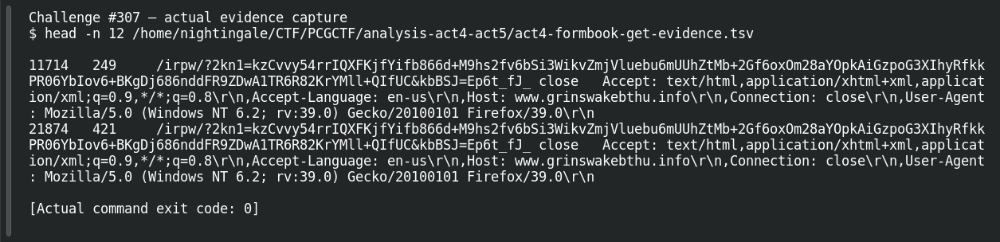

# ACT 4 — First to Last: Malware Attribution

**Platform:** PCGCTF · **Challenge ID:** 307 · **Category:** Network Forensics · **Points:** 100

**Status:** Answer backed by the capture and cited public sources. Exact PCGCTF submission not re-confirmed.

## The challenge

Attribute the malware family in the First-to-Last incident.

## Solving it

The beacon pattern is the giveaway — repeated requests to randomized `.info` hosts with a short `/xxxx/` path and long encoded query parameters, which is FormBook's HTTP C2 shape:

```sh
tshark -nr act.pcap -Y 'http.request' -T fields -e http.host -e http.request.uri | head
```

```text
www.grinswakebthu.info  /irpw/
www.grinswakebthu.info  /irpw/?2kn1=...&kbBSJ=...
```

The randomized-host + encoded-GET pattern, matched to the public analysis, attributes this to FormBook.

## Screenshot



## Flag

```text
pcgCTF{FormBook}
```

## Takeaway

FormBook's traffic fingerprint is the giveaway: pseudo-random `.info`/`.xyz` hosts, a short path, and a long base64-ish query string on the GET.

## Reference

- [Original challenge description](../../solved/network-forensics/307-act-4-first-to-last-malware-attribution/README.md)
