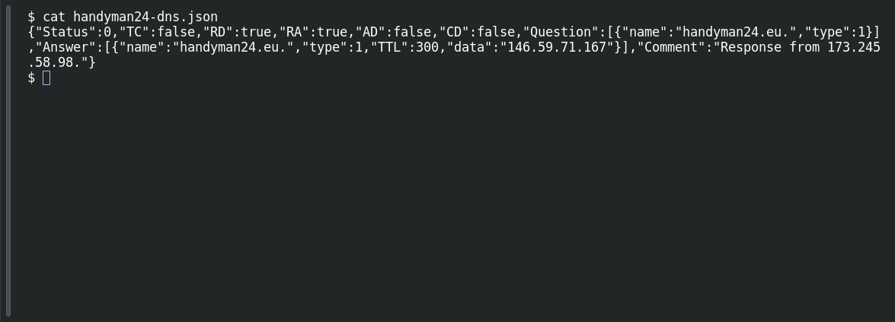

# ACT 4 — First to Last: Infrastructure Pivot

**Platform:** PCGCTF · **Challenge ID:** 308 · **Category:** Network Forensics / OSINT · **Points:** 100

**Status:** Answer backed by the saved challenge prompt and DNS lookup. Exact PCGCTF submission not re-confirmed.

**Evidence:** Source: [Public DNS answer linking handyman24.eu to 146.59.71.167](../../analysis-act4-act5/handyman24-dns.json). Packet/stream: not applicable to this OSINT lookup.

## The challenge

Identify the domain associated with starting IP `146.59.71.167` using a public DNS or reverse-host lookup. The saved challenge description explicitly names `handyman24.eu` as resolving to this address.

## Solving it

The saved DNS lookup records `handyman24.eu` resolving to `146.59.71.167`. This is a public DNS pivot, rather than a domain recovered from HTTP Host headers.

The capture's observed C2 HTTP Host is `www.grinswakebthu.info`. It is a separate name. Sharing an IP address does not establish that both domains have the same owner or role.

The answer requested by the saved prompt is `handyman24.eu`. The screenshot shows the archived lookup record.

## Screenshot

Local inspection of the archived lookup response; this is not a new external lookup.



## Flag

```text
pcgCTF{handyman24.eu}
```

## Takeaway

Keep a public DNS association separate from the hostname observed in captured C2 requests.

## Reference

- [Original challenge description](../../unsolved/osint/308-act-4-first-to-last-infrastructure-pivot/README.md)
- [Saved DNS and capture analysis](../../analysis-act4-act5/answers.md)
