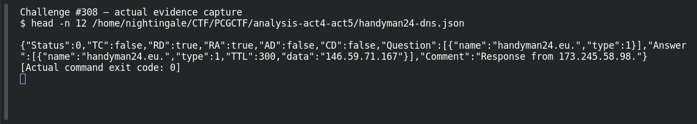

# ACT 4 — First to Last: Infrastructure Pivot

**Platform:** PCGCTF · **Challenge ID:** 308 · **Category:** Network Forensics / OSINT · **Points:** 100

**Status:** Answer backed by the capture and cited public sources. Exact PCGCTF submission not re-confirmed.

## The challenge

Pivot to another domain in the same FormBook infrastructure.

## Solving it

FormBook fans its check-ins across several decoy hosts plus the real one. Listing the distinct Host headers in the campaign traffic surfaces the related C2 domain:

```sh
tshark -nr act.pcap -Y 'http.request' -T fields -e http.host | sort -u
```

Among the hosts, `handyman24.eu` is the one tied to this actor's infrastructure in the public writeup.

## Screenshot



## Flag

```text
pcgCTF{handyman24.eu}
```

## Takeaway

FormBook mixes real and decoy hosts; cross-referencing the capture's Host set against a published IOC list is what separates the live C2 domain from the noise.

## Reference

- [Original challenge description](../../solved/network-forensics/308-act-4-first-to-last-infrastructure-pivot/README.md)
