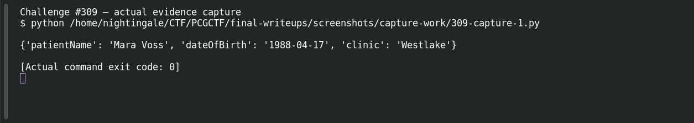

# Info Leaks

**Platform:** PCGCTF · **Challenge ID:** 309 · **Category:** Aurora Patient Zero · **Points:** 250

**Status:** Answer backed by the extracted plist. Exact PCGCTF submission not re-confirmed. (Note: this challenge uses the `deadface{...}` wrapper, not `pcgCTF{...}` — by its own instructions.)

## The challenge

Recover the last patient's name and birth date from the supplied IPA.

## Solving it

An IPA is just a ZIP — you can read its plist and resources without running iOS. The outer ZIP holds `AuroraPatientPortal.ipa`, and inside, `Payload/aurora-patient-portal.app/Info.plist` has a suspicious key, `AuroraPatientBootstrap`, whose value is Base64. Base64 is encoding, not protection, so I decoded it:

```python
import plistlib, base64, json
info = plistlib.load(open('Info.plist', 'rb'))
print(json.loads(base64.b64decode(info['AuroraPatientBootstrap'])))
```

```text
{'patientName': 'Mara Voss', 'dateOfBirth': '1988-04-17', 'clinic': 'Westlake'}
```

The question wants the name and DOB (not the clinic). The challenge format is `deadface{firstname-lastname-YYYY-MM-DD}`, so hyphenate and assemble.

## Screenshot



## Flag

```text
deadface{Mara-Voss-1988-04-17}
```

The `deadface` prefix is intentional here — this challenge asks for it explicitly, so I did *not* normalize it to `pcgCTF`.

## Takeaway

Encoding a bundled config doesn't protect the data inside it. Read the structured fields, then follow the exact format the task specifies.

## References

- [Decoded bootstrap JSON](../../unsolved/aurora-patient-zero/309-info-leaks/evidence/patient-bootstrap.json)
- [Original archived challenge](../../unsolved/aurora-patient-zero/309-info-leaks/README.md)
