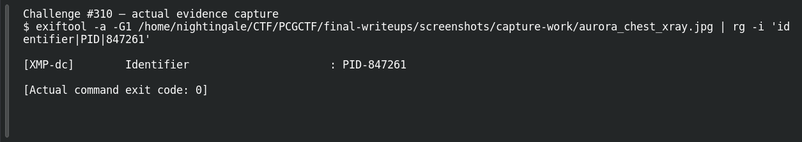

# Down the Rabbit Hole

| Field | Details |
|---|---|
| Platform | PCGCTF |
| Challenge ID | 310 |
| Technical category | Aurora Patient Zero |
| Points in saved inventory | 100 |
| Difficulty | Not stated in the saved challenge description |
| Objective | Recover the patient ID from a hidden file field in the Aurora package. |
| Result | `deadface{847261}` |

**Needs Flag Verification:** the answer is supported by the evidence described below, but its exact submission has not been confirmed accepted by PCGCTF.

## Reading the clues

The task says no emulator or debugger is required. That favors resource metadata over runtime interception; the bundled chest X-ray has a meaningful identifier in XMP.

## Working through the evidence

### 1. Inspect the resource metadata

The original package supplies aurora_chest_xray.jpg. The preserved XMP evidence contains:

```xml
<dc:identifier>PID-847261</dc:identifier>
```

The XMLnamespace dc identifies a Dublin Core field; the PID- prefix labels the identifier rather than forming part of the numeric patient ID.

A reproducible focused inspection is:

```sh
exiftool -a -G1 aurora_chest_xray.jpg
```

`-a` includes duplicate tags instead of suppressing them; `-G1` shows their metadata group. This helps distinguish an XMPidentifier from an unrelated filename or softwarecomment. The recorded evidence, not an invented command transcript, establishes the value above.

### 2. Corroborate the number against the packaged data

A read-only query of aurora_meds.sqlite finds patient 847261, the unique row containing Ibuprofen. That is an independent consistency check with the continuation task SQL Skillz, not a reason to expose other patients’ medication records.

### 3. Format only the requested ID

Remove the label PID- and use **847261** in the explicitly requested deadface{ID} wrapper. No name, clinic or timestamp belongs in this answer.

### Reproduction inputs and preserved output

Use the original artifact links below to replace any angle-bracketed input path. Those placeholders select local files; they are not missing exploit parameters. Commands in this draft explain a recorded method and should be checked against the preserved hashes before rerunning. The linked original investigation retains additional tool output and exact filenames; where a result is reported above, its verification record is linked rather than invented as a terminal screenshot.

## Captured screenshots and evidence

Captured on 2026-10-29 from actual terminal sessions or browser views. Captions distinguish new results, preserved records, source images and blockers. No platform acceptance is inferred from these images.

### Challenge #310 — actual evidence capture



Actual EXIF/XMP extraction from original bundled X-ray.

Command/action actually executed:

```sh
exiftool -a -G1 /home/nightingale/CTF/PCGCTF/final-writeups/screenshots/capture-work/aurora_chest_xray.jpg | rg -i 'identifier|PID|847261'
```

[Actual command transcript](../screenshots/capture-work/310-xmp.terminal.log) · [Execution record](../screenshots/capture-work/310-xmp.result.json). Notice the result fields discussed in the corresponding solution step; the transcript retains lines that extend beyond the screenshot viewport.

## Flag discovery and final verification

The saved submission candidate is **`deadface{847261}`**. OriginalJPEG XMP and read-onlySQLite corroboration support the number; siteacceptance is untested.

The remaining platform check is to open the specific PCGCTF challenge, copy the documented payload with its exact capitalization, spaces and punctuation, and capture the real acceptance or rejection response. No successful submission is inferred from the existence of the answer. If rejected, record the response and compare the stated format before changing the evidence-backed payload.

## What this challenge taught me

Image metadata can act as an index into another packaged data source. Cross-check a recovered identifier before following it.

## Evidence and references

[Original archived challenge](../../unsolved/aurora-patient-zero/310-down-the-rabbit-hole/README.md)

- [Decisive preserved verification results](../../analysis-team-verification/aurora-identities.json)
- [Original shared IPA archive](../../unsolved/aurora-patient-zero/309-info-leaks/files/AuroraPatientPortal.ipa.zip)
- [Actual XMP identifier](../../unsolved/aurora-patient-zero/310-down-the-rabbit-hole/evidence/xray-metadata.xmp)
- [Preserved investigation notes](../../unsolved/aurora-patient-zero/310-down-the-rabbit-hole/solution.md)

**Provenance:** Original local artifacts and preserved independent extraction/source verification; drafted without claiming new live attacks or fabricated executions.
