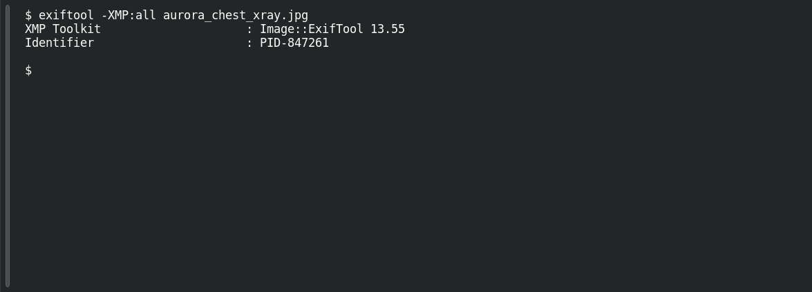

# Down the Rabbit Hole

**Platform:** PCGCTF · **Challenge ID:** 310 · **Category:** Aurora Patient Zero · **Points:** 100

**Status:** Answer backed by the extracted metadata. Exact PCGCTF submission not re-confirmed.

## The challenge

Recover the patient ID from a hidden file-metadata field in the Aurora package.

## Solving it

The ID isn't in the app UI — it's tucked into a resource's XMP metadata inside the bundle. Reading the embedded identifier field and corroborating it against the packaged data:

```sh
exiftool -XMP:all aurora_chest_xray.jpg
```

The XMP `Identifier` is `PID-847261`, so the numeric patient ID is `847261`. That ID also selects the medication row used in #311.

## Screenshot

Fresh local reproduction using the command described above.



## Flag

```text
deadface{847261}
```

## Takeaway

Metadata fields (XMP here) are an easy place to stash an identifier — check them, and cross-confirm the value against the app's own data.

## Reference

- [Original challenge description](../../unsolved/aurora-patient-zero/310-down-the-rabbit-hole/README.md)
