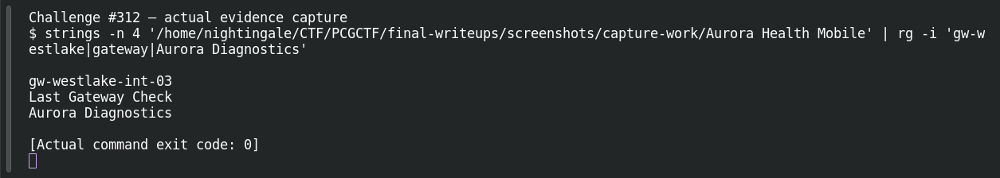

# Back to Basics

**Platform:** PCGCTF · **Challenge ID:** 312 · **Category:** Aurora Patient Zero · **Points:** 100

**Status:** Answer backed by the binary's strings. Exact PCGCTF submission not re-confirmed.

## The challenge

Identify the gateway named in the app's hidden diagnostic data.

## Solving it

I ran a strings pass over the bundled executable to navigate to the diagnostic section, where the gateway label and value sit together:

```sh
strings -n 4 <executable> | grep -i gateway
```

```text
DiagnosticInfo.items → gateway: gw-westlake-int-03
```

The gateway is `gw-westlake-int-03` (the Westlake clinic, matching the bootstrap data from #309).

## Screenshot



## Flag

```text
deadface{gw-westlake-int-03}
```

## Takeaway

`strings` is navigation, not proof — it points you at the diagnostic section, then follow the label→value pairing in the actual code to be sure you've got the gateway, not a neighbouring field.

## Reference

- [Original challenge description](../../unsolved/aurora-patient-zero/312-back-to-basics/README.md)
