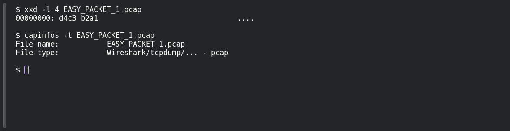

# EASY PACKET 1 #01 — The Capture Signature

**Platform:** PCGCTF · **Challenge ID:** 83 · **Category:** Network Forensics · **Points:** 100

**Status:** Technically solved, but the exact accepted flag wording is unresolved — several obvious phrasings were rejected, and I don't have a confirmed string.

## The challenge

Identify the capture-file format from the artifact (`EASY_PACKET_1.pcap`).

## Solving it

A `.pcap` extension is a hint, not proof — the extension can be anything. So I read the file's magic bytes:

```sh
xxd -l 4 EASY_PACKET_1.pcap
```

```text
00000000: d4c3 b2a1                                ....
```

`d4 c3 b2 a1` is the classic libpcap/tcpdump magic (little-endian). `capinfos` agrees:

```sh
capinfos -t EASY_PACKET_1.pcap
```

So the format is classic **pcap (libpcap)**.

## Screenshots

Fresh local reproduction using the commands described above.



## Flag

No confirmed flag. The format is pcap/libpcap, but the teammate reports that `pcap`, `PCAP`, `libpcap`, `Libpcap`, `LIBPCAP`, `Packet Capture` and `Packet Capture Format` were all rejected. This is a grader exact-string problem, not a technical one.

## Still to do

- Open the live challenge, record the exact prompt / required wrapper / hint, and get the organizer's accepted vocabulary — attaching the magic-byte evidence rather than blindly guessing more variants.

## Takeaway

Confirm a file format from its magic bytes plus an independent parser, not the extension. And keep "I know the format" separate from "I know the grader's exact phrase" — here only the first is settled.

## Reference

- [Original challenge description](../../unsolved/network-forensics/083-easy-packet-1-01-the-capture-signature/README.md)
