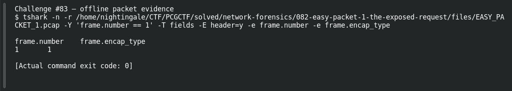
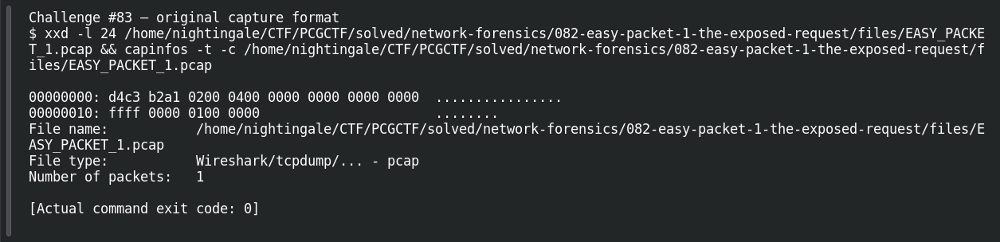

# EASY PACKET 1 #01  The Capture Signature

| Item | Record |
|---|---|
| Platform | PCGCTF |
| Challenge ID | 83 |
| Category | Network Forensics |
| Points | 100 |
| Difficulty | Not separately recorded in the available inventory |
| Verification | Answer Known — the technical result is reproduced, but the exact accepted flag phrase remains unresolved. |

## Challenge and objective

Identify the capture-file format from the supplied artifact.

The original description and prerequisite chain are preserved in [the challenge README](../../unsolved/network-forensics/083-easy-packet-1-01-the-capture-signature/README.md). The supplied evidence is `EASY_PACKET_1.pcap`; related storyline questions reuse the same capture rather than providing another download.

## Initial analysis

A .pcap suffix is a clue, but it can be changed without changing the file. I checked the global file header before interpreting any network packet. The file signature is evidence about the capture container, not Ethernet or HTTP.

I kept the original capture intact and used offline packet analysis. The file’s SHA-256 is `e4735559a704fcd56ac790602e875a713f94a665af16ecd3ad49ea40ff394faa`. This identifies the exact evidence behind the frame references; no reconstructed program was executed and no request was sent to an address found inside the capture.

## Step-by-step solution

### 1. Inspect the file signature before its contents

```sh
xxd -l 24 /home/nightingale/CTF/PCGCTF/solved/network-forensics/082-easy-packet-1-the-exposed-request/files/EASY_PACKET_1.pcap
```

`-l 24` limits `xxd` to the first 24 bytes, enough to show the pcap global header. The left column is a byte offset; the hexadecimal column contains the signature.

Recorded output from this pass:

```text
00000000: d4c3 b2a1 0200 0400 0000 0000 0000 0000  ................
00000010: ffff 0000 0100 0000                      ........
```

### 2. Ask an independent parser for the file type

```sh
capinfos -t -c /home/nightingale/CTF/PCGCTF/solved/network-forensics/082-easy-packet-1-the-exposed-request/files/EASY_PACKET_1.pcap
```

`capinfos -t -c` reads the format and packet count. This tests the interpretation of the header without trusting the filename extension.

Recorded output:

```text
File name:           /home/nightingale/CTF/PCGCTF/solved/network-forensics/082-easy-packet-1-the-exposed-request/files/EASY_PACKET_1.pcap
File type:           Wireshark/tcpdump/... - pcap
Number of packets:   1
```

### 3. Interpret the result

The technical answer is classic pcap/libpcap. Garcia reports that pcap, PCAP, libpcap and other phrasings were rejected. Those reports expose an exact-string grading problem; they do not change the file bytes or establish a successful alternative.

## Captured screenshots and evidence

Captured on 2026-10-29 from actual terminal sessions or browser views. Captions distinguish new results, preserved records, source images and blockers. No platform acceptance is inferred from these images.

### Challenge #83 — offline packet evidence



Fresh execution of the draft’s field-specific TShark command.

Command/action actually executed:

```sh
tshark -n -r /home/nightingale/CTF/PCGCTF/solved/network-forensics/082-easy-packet-1-the-exposed-request/files/EASY_PACKET_1.pcap -Y 'frame.number == 1' -T fields -E header=y -e frame.number -e frame.encap_type
```

[Actual command transcript](../screenshots/capture-work/083-network.terminal.log) · [Execution record](../screenshots/capture-work/083-network.result.json). Notice the result fields discussed in the corresponding solution step; the transcript retains lines that extend beyond the screenshot viewport.

### Challenge #83 — original capture format



Actual magic bytes and independent capture file classification; encapsulation alone does not identify the container.

Command/action actually executed:

```sh
xxd -l 24 /home/nightingale/CTF/PCGCTF/solved/network-forensics/082-easy-packet-1-the-exposed-request/files/EASY_PACKET_1.pcap && capinfos -t -c /home/nightingale/CTF/PCGCTF/solved/network-forensics/082-easy-packet-1-the-exposed-request/files/EASY_PACKET_1.pcap
```

[Actual command transcript](../screenshots/capture-work/083-signature-proof.terminal.log) · [Execution record](../screenshots/capture-work/083-signature-proof.result.json). Notice the result fields discussed in the corresponding solution step; the transcript retains lines that extend beyond the screenshot viewport.

## Flag discovery and verification

**Identified answer:** pcap (classic libpcap/tcpdump format). No successful final flag phrase is known. The absence of a ready flag is deliberate, not a missing decoding step.

## Missing Evidence and Final Verification

**Known uncertainty:** file-format naming: classic pcap/libpcap versus an organizer-specific label. This is more than a confirmed capitalization issue: the private grading phrase is unavailable. Garcia reports pcap, PCAP, libpcap, Libpcap, LIBPCAP, Packet Capture and Packet Capture Format rejected. These are teammate reports, not newly observed rejection screenshots.

1. **Reproduce the technical answer.** The technical command was run; its actual capture and transcript are linked above. The command appears in full above and has already been checked against the saved capture.
2. **Capture decisive visual evidence.** **Technical evidence captured:** see the actual command result above. This does not establish the organizer’s accepted flag wording.
3. **Read the current question and hint.** [ACTION TO COMPLETE: Open `https://cgcybercom.online/challenges#83` under the authorized contestant session when available. Record the complete prompt, required wrapper, any provided example, and the free hint. Capture `screenshots/083-prompt-and-hint.png` with those items visible.] Historical metadata remains linked below; a live screenshot is still missing.
4. **Resolve the scope with evidence.** [THOUGHT PROCESS TO COMPLETE: Compare the observed technical answer with the exact prompt and hint. State which word, delimiter, capitalization or answer scope is actually supported by the new evidence; if none is specified, record that explicitly.] Do not keep varying a technically correct file-type label blindly. Ask for the accepted vocabulary or a grader correction with the magic-byte evidence attached.
5. **Record the final check.** [FINAL FLAG TO ESTABLISH: the organizer-supported phrase inside `pcgCTF{...}`, without inventing text here.] **Acceptance evidence unavailable:** no new platform submission or grader result was recorded. A rejection must remain a rejection in the notes; update the status only after evidence justifies it.

## Conclusion and lesson

Use a magic value and an independent format parser together. Once both agree, distinguish uncertainty about the grader’s phrase from uncertainty about the file format. The remaining task is to document the accepted submission wording; the technical finding itself is already reproduced.

## Reproduction evidence and references

- [Original challenge description](../../unsolved/network-forensics/083-easy-packet-1-01-the-capture-signature/README.md)
- [Actual TShark field output](../evidence/network/083-fields.tsv)
- [Commands, hashes and reproduction results](../evidence/network/reproduction.json)
- [TShark version](../evidence/network/tshark-version.txt)
- [TShark official manual](https://www.wireshark.org/docs/man-pages/tshark.html)

- [Earlier local solution and provenance](../../unsolved/network-forensics/083-easy-packet-1-01-the-capture-signature/solution.md)

- [Garcia Day 1 report — attributed formatting/acceptance evidence](../../team-writeups/garcia-day1/source.md)
