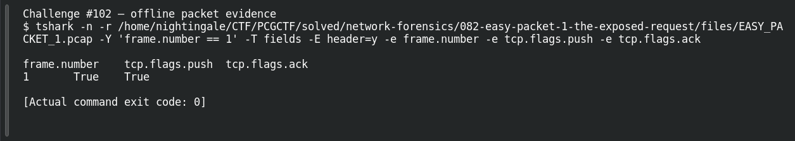

# EASY PACKET 1 #20  Push to the Application

| Item | Record |
|---|---|
| Platform | PCGCTF |
| Challenge ID | 102 |
| Category | Network Forensics |
| Points | 100 |
| Difficulty | Not separately recorded in the available inventory |
| Verification | Answer Known — the technical result is reproduced, but the exact accepted flag phrase remains unresolved. |

## Challenge and objective

Explain the PSH flag’s effect on application delivery.

The original description and prerequisite chain are preserved in [the challenge README](../../unsolved/network-forensics/102-easy-packet-1-20-push-to-the-application/README.md). The supplied evidence is `EASY_PACKET_1.pcap`; related storyline questions reuse the same capture rather than providing another download.

## Initial analysis

The packet establishes that PSH is set, but the question asks what that means. Merely returning PSH names the flag without explaining its role.

I kept the original capture intact and used offline packet analysis. The file’s SHA-256 is `e4735559a704fcd56ac790602e875a713f94a665af16ecd3ad49ea40ff394faa`. This identifies the exact evidence behind the frame references; no reconstructed program was executed and no request was sent to an address found inside the capture.

## Step-by-step solution

### 1. Select the field at the correct protocol layer

The PUSH function concerns making received data available to the receiving application promptly rather than waiting to accumulate additional data. It does not define message boundaries in TCP’s byte stream or guarantee a particular application read size.

```sh
tshark -n \
  -r /home/nightingale/CTF/PCGCTF/solved/network-forensics/082-easy-packet-1-the-exposed-request/files/EASY_PACKET_1.pcap \
  -Y 'frame.number == 1' \
  -T fields -E header=y -e frame.number -e tcp.flags.push -e tcp.flags.ack
```

`-n` disables address/name resolution so that recorded numeric addresses stay visible. `-r` reads the existing capture, and `-Y` applies a display filter after decoding. `-T fields` outputs selected fields; each `-e` adds one named column, and `-E header=y` records the column names. `frame.number == 1` is appropriate because the independent capture count is one; it is not being used to prove that count.

**Actual reproduced output** (tab-separated; full lines are preserved in the linked TSV):

```text
frame.number	tcp.flags.push	tcp.flags.ack
1	True	True
```

### 2. Interpret the result

The technical answer is known. Garcia reports several plausible English phrases rejected, so neither our explanation nor the captured bit proves the exact string stored by the CTF grader.

The [TCP specification, RFC 9293](https://www.rfc-editor.org/rfc/rfc9293.html), is the relevant authority for PUSH semantics. It supports a technical explanation, but its wording should not be represented as the CTF’s secret accepted string. TCP remains a byte-stream protocol even when PSH is used.

## Captured screenshots and evidence

Captured on 2026-10-29 from actual terminal sessions or browser views. Captions distinguish new results, preserved records, source images and blockers. No platform acceptance is inferred from these images.

### Challenge #102 — offline packet evidence



Fresh execution of the draft’s field-specific TShark command.

Command/action actually executed:

```sh
tshark -n -r /home/nightingale/CTF/PCGCTF/solved/network-forensics/082-easy-packet-1-the-exposed-request/files/EASY_PACKET_1.pcap -Y 'frame.number == 1' -T fields -E header=y -e frame.number -e tcp.flags.push -e tcp.flags.ack
```

[Actual command transcript](../screenshots/capture-work/102-network.terminal.log) · [Execution record](../screenshots/capture-work/102-network.result.json). Notice the result fields discussed in the corresponding solution step; the transcript retains lines that extend beyond the screenshot viewport.

## Flag discovery and verification

**Identified answer:** Push buffered data to the receiving application without waiting for more data. No successful final flag phrase is known. The absence of a ready flag is deliberate, not a missing decoding step.

## Missing Evidence and Final Verification

**Known uncertainty:** the exact English description of PSH behavior, potentially combined with required punctuation or spaces. This is more than a confirmed capitalization issue: the private grading phrase is unavailable. Garcia reports PSH and two prompt-delivery sentence variants rejected. These are teammate reports, not newly observed rejection screenshots.

1. **Reproduce the technical answer.** The technical command was run; its actual capture and transcript are linked above. The command appears in full above and has already been checked against the saved capture.
2. **Capture decisive visual evidence.** **Technical evidence captured:** see the actual command result above. This does not establish the organizer’s accepted flag wording.
3. **Read the current question and hint.** [ACTION TO COMPLETE: Open `https://cgcybercom.online/challenges#102` under the authorized contestant session when available. Record the complete prompt, required wrapper, any provided example, and the free hint. Capture `screenshots/102-prompt-and-hint.png` with those items visible.] Historical metadata remains linked below; a live screenshot is still missing.
4. **Resolve the scope with evidence.** [THOUGHT PROCESS TO COMPLETE: Compare the observed technical answer with the exact prompt and hint. State which word, delimiter, capitalization or answer scope is actually supported by the new evidence; if none is specified, record that explicitly.] The next evidence must establish the organizer’s phrase; the packet and RFC only establish the behavior.
5. **Record the final check.** [FINAL FLAG TO ESTABLISH: the organizer-supported phrase inside `pcgCTF{...}`, without inventing text here.] **Acceptance evidence unavailable:** no new platform submission or grader result was recorded. A rejection must remain a rejection in the notes; update the status only after evidence justifies it.

## Conclusion and lesson

Use a protocol specification for semantics and a packet for observed state. Neither can reveal an organizer’s private grading phrase. The remaining task is to document the accepted submission wording; the technical finding itself is already reproduced.

## Reproduction evidence and references

- [Original challenge description](../../unsolved/network-forensics/102-easy-packet-1-20-push-to-the-application/README.md)
- [Actual TShark field output](../evidence/network/102-fields.tsv)
- [Commands, hashes and reproduction results](../evidence/network/reproduction.json)
- [TShark version](../evidence/network/tshark-version.txt)
- [TShark official manual](https://www.wireshark.org/docs/man-pages/tshark.html)

- [Earlier local solution and provenance](../../unsolved/network-forensics/102-easy-packet-1-20-push-to-the-application/solution.md)

- [Garcia Day 1 report — attributed formatting/acceptance evidence](../../team-writeups/garcia-day1/source.md)
