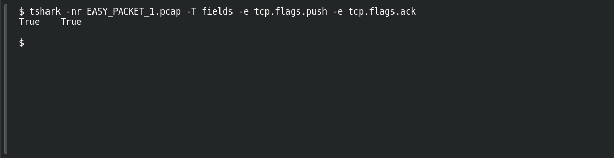

# EASY PACKET 1 #20 — Push to the Application

**Platform:** PCGCTF · **Challenge ID:** 102 · **Category:** Network Forensics · **Points:** 100

**Status:** Technically solved, but the exact accepted wording is unresolved — several plausible phrasings were rejected.

## The challenge

Explain what the TCP PSH flag does to application delivery — not just that it's set.

## Solving it

The packet confirms PSH is set:

```sh
tshark -nr EASY_PACKET_1.pcap -T fields -e tcp.flags.push -e tcp.flags.ack
```

But the question is about meaning: the PUSH function tells the receiver to hand the buffered data up to the application *promptly*, instead of waiting to accumulate more. It does **not** mark message boundaries — TCP is still a byte stream — and it doesn't guarantee any particular read size ([RFC 9293](https://www.rfc-editor.org/rfc/rfc9293.html)).

## Screenshot

Fresh local reproduction using the command described above.



## Flag

No confirmed flag. The behaviour is clear ("push buffered data to the receiving application without waiting for more"), but the teammate reports `PSH` and a couple of prompt-delivery sentence variants were rejected. The grader's exact phrase isn't known.

## Still to do

- Pull the live prompt/hint to learn whether the grader wants a label, a specific sentence, or a particular wording — the packet and RFC only establish the behaviour, not the accepted string.

## Takeaway

Use the RFC for semantics and the packet for observed state — but neither reveals a grader's private phrasing. The technical answer is settled; the wording isn't.

## Reference

- [Original challenge description](../../unsolved/network-forensics/102-easy-packet-1-20-push-to-the-application/README.md)
