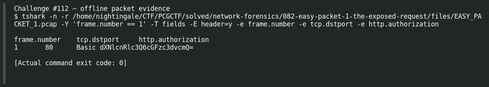

# EASY PACKET 1 #30  Cleartext on the Wire

| Item | Record |
|---|---|
| Platform | PCGCTF |
| Challenge ID | 112 |
| Category | Network Forensics |
| Points | 100 |
| Difficulty | Not separately recorded in the available inventory |
| Verification | Answer Known — the technical result is reproduced, but the exact accepted flag phrase remains unresolved. |

## Challenge and objective

Explain the credential-exposure weakness and the relevant transport fix.

The original description and prerequisite chain are preserved in [the challenge README](../../unsolved/network-forensics/112-easy-packet-1-30-cleartext-on-the-wire/README.md). The supplied evidence is `EASY_PACKET_1.pcap`; related storyline questions reuse the same capture rather than providing another download.

## Initial analysis

The weakness requires two observations together: an Authorization token that reversibly encodes credentials, and an unencrypted HTTP request visible on the network. Naming Base64 alone misses the transport issue.

I kept the original capture intact and used offline packet analysis. The file’s SHA-256 is `e4735559a704fcd56ac790602e875a713f94a665af16ecd3ad49ea40ff394faa`. This identifies the exact evidence behind the frame references; no reconstructed program was executed and no request was sent to an address found inside the capture.

## Step-by-step solution

### 1. Inspect the relevant HTTP fields

The packet carries Basic authentication in readable HTTP. A passive reader can recover usertest:password. HTTPS adds TLS protection for the HTTP exchange; Base64 by itself supplies none.

```sh
tshark -n \
  -r /home/nightingale/CTF/PCGCTF/solved/network-forensics/082-easy-packet-1-the-exposed-request/files/EASY_PACKET_1.pcap \
  -Y 'frame.number == 1' \
  -T fields -E header=y -e frame.number -e tcp.dstport -e http.authorization
```

`-n` disables address/name resolution so that recorded numeric addresses stay visible. `-r` reads the existing capture, and `-Y` applies a display filter after decoding. `-T fields` outputs selected fields; each `-e` adds one named column, and `-E header=y` records the column names. `frame.number == 1` is appropriate because the independent capture count is one; it is not being used to prove that count.

**Actual reproduced output** (tab-separated; full lines are preserved in the linked TSV):

```text
frame.number	tcp.dstport	http.authorization
1	80	Basic dXNlcnRlc3Q6cGFzc3dvcmQ=
```

### 2. Interpret the result

The technical issue and remedy are known, but the exact English phrase accepted by the platform has not been recovered. Garcia’s failed short variants do not tell us whether the grader expects a combined explanation, a specific label or different wording.

### Decode the Basic credential token

```sh
python - <<'PY'
import base64
token = 'dXNlcnRlc3Q6cGFzc3dvcmQ='
print(base64.b64decode(token, validate=True).decode('ascii'))
PY
```

The string is the token captured after `Basic`, not a guessed password. `validate=True` rejects malformed Base64 instead of silently ignoring invalid characters, and ASCII decoding makes the resulting credential delimiters explicit. Independently reproduced result:

```text
usertest:password
```

The username is `usertest` and the password is `password`. These are challenge-provided demonstration credentials recovered from the supplied capture. The result leads directly to the answer; no login attempt against Twitter or any external service is necessary. The scheme’s representation and TLS requirement are described in [RFC 7617](https://www.rfc-editor.org/rfc/rfc7617.html).

## Captured screenshots and evidence

Captured on 2026-10-29 from actual terminal sessions or browser views. Captions distinguish new results, preserved records, source images and blockers. No platform acceptance is inferred from these images.

### Challenge #112 — offline packet evidence



Fresh execution of the draft’s field-specific TShark command.

Command/action actually executed:

```sh
tshark -n -r /home/nightingale/CTF/PCGCTF/solved/network-forensics/082-easy-packet-1-the-exposed-request/files/EASY_PACKET_1.pcap -Y 'frame.number == 1' -T fields -E header=y -e frame.number -e tcp.dstport -e http.authorization
```

[Actual command transcript](../screenshots/capture-work/112-network.terminal.log) · [Execution record](../screenshots/capture-work/112-network.result.json). Notice the result fields discussed in the corresponding solution step; the transcript retains lines that extend beyond the screenshot viewport.

## Flag discovery and verification

**Identified answer:** HTTP Basic credentials are recoverable over unencrypted HTTP; use HTTPS (HTTP over TLS). No successful final flag phrase is known. The absence of a ready flag is deliberate, not a missing decoding step.

## Missing Evidence and Final Verification

**Known uncertainty:** whether the grader wants a weakness label, a remedy, or a specific combined phrase; exact wording is not established. This is more than a confirmed capitalization issue: the private grading phrase is unavailable. Garcia reports HTTPS, Cleartext credentials and HTTPS, and a capitalized variant rejected. These are teammate reports, not newly observed rejection screenshots.

1. **Reproduce the technical answer.** The technical command was run; its actual capture and transcript are linked above. The command appears in full above and has already been checked against the saved capture.
2. **Capture decisive visual evidence.** **Technical evidence captured:** see the actual command result above. This does not establish the organizer’s accepted flag wording.
3. **Read the current question and hint.** [ACTION TO COMPLETE: Open `https://cgcybercom.online/challenges#112` under the authorized contestant session when available. Record the complete prompt, required wrapper, any provided example, and the free hint. Capture `screenshots/112-prompt-and-hint.png` with those items visible.] Historical metadata remains linked below; a live screenshot is still missing.
4. **Resolve the scope with evidence.** [THOUGHT PROCESS TO COMPLETE: Compare the observed technical answer with the exact prompt and hint. State which word, delimiter, capitalization or answer scope is actually supported by the new evidence; if none is specified, record that explicitly.] Present both the demonstrated weakness and TLS remedy to the organizer; ask for the expected answer scope rather than guessing further variants.
5. **Record the final check.** [FINAL FLAG TO ESTABLISH: the organizer-supported phrase inside `pcgCTF{...}`, without inventing text here.] **Acceptance evidence unavailable:** no new platform submission or grader result was recorded. A rejection must remain a rejection in the notes; update the status only after evidence justifies it.

## Conclusion and lesson

Demonstrate the exposure, explain the fix, then report any grading uncertainty without replacing it with unsupported guesses. The remaining task is to document the accepted submission wording; the technical finding itself is already reproduced.

## Reproduction evidence and references

- [Original challenge description](../../unsolved/network-forensics/112-easy-packet-1-30-cleartext-on-the-wire/README.md)
- [Actual TShark field output](../evidence/network/112-fields.tsv)
- [Commands, hashes and reproduction results](../evidence/network/reproduction.json)
- [TShark version](../evidence/network/tshark-version.txt)
- [TShark official manual](https://www.wireshark.org/docs/man-pages/tshark.html)

- [Earlier local solution and provenance](../../unsolved/network-forensics/112-easy-packet-1-30-cleartext-on-the-wire/solution.md)

- [Garcia Day 1 report — attributed formatting/acceptance evidence](../../team-writeups/garcia-day1/source.md)
