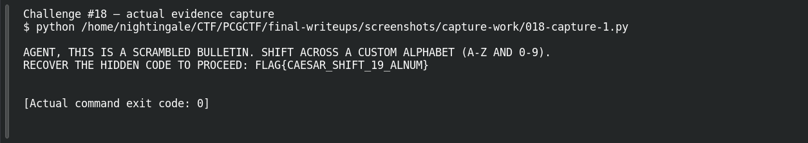

# Rotation 36

## Challenge information and current failure

**PCGCTF #18 · Cryptography · 100 points.** The downloaded teaching note calls the technique beginner Caesar over an alphanumeric alphabet. The original platform page showed an Apprentice badge in the user-supplied screenshot. [Challenge description](../../unsolved/cryptography/018-rotation-36/README.md) and [supplied instructions](../../unsolved/cryptography/018-rotation-36/files/README.md).

**Decoded result:** `FLAG{CAESAR_SHIFT_19_ALNUM}`. **Status: Rejected Flag — Under Investigation.** The user reports that both the literal recovered string and `pcgCTF{CAESAR_SHIFT_19_ALNUM}` were rejected. Earlier assistant notes also record an actual Incorrect response for `pcgCTF{caesar_shift_19_alnum}`. No accepted replacement is known.

The original screenshot showing the wrapper-adjusted rejection was supplied in the conversation, but its temporary file no longer exists on disk. It has not been recreated or passed off as an available screenshot. The distinction matters: one rejection was visibly documented in chat, two other outcomes are preserved as user/assistant reports, and no current authenticated scoreboard capture is available.

## Decoding the custom alphabet

The attachment defines the exact alphabet as `ABCDEFGHIJKLMNOPQRSTUVWXYZ0123456789`, a ring of 36 characters. A Caesar rotation replaces each character with another position in that ring. Unlike the familiar 26-letter cipher, the position after Z is 0, and digits are shifted too. Braces, underscores, punctuation and newlines remain unchanged.

The original instruction says the cipher is case-insensitive. It can therefore establish uppercase decoded symbols, but cannot reconstruct arbitrary original mixed-case spelling that was lost before encoding.

The independent pass subtracted 19 modulo 36 and then re-encrypted the full plaintext with +19:

```python
from pathlib import Path
alphabet = 'ABCDEFGHIJKLMNOPQRSTUVWXYZ0123456789'
ciphertext = Path('cipher.txt').read_text()
def rotate(text, shift):
    return ''.join(alphabet[(alphabet.index(c.upper()) + shift) % 36]
                   if c.upper() in alphabet else c for c in text)
plaintext = rotate(ciphertext, -19)
assert rotate(plaintext, 19) == ciphertext
print(plaintext)
```

The conditional preserves nonalphabet characters. `% 36` wraps at the ring boundary. A negative rotation undoes the encryption rather than applying the encryption direction again. The assertion compares the entire artifact, including whitespace; it is stronger than merely finding a readable phrase.

Actual output:

```text
AGENT, THIS IS A SCRAMBLED BULLETIN. SHIFT ACROSS A CUSTOM ALPHABET (A-Z AND 0-9).
RECOVER THE HIDDEN CODE TO PROCEED: FLAG{CAESAR_SHIFT_19_ALNUM}
```

The [round-trip record](../evidence/018/round-trip.json) preserves the original SHA-256, ciphertext, exact plaintext and successful equality check. There is no second encoded suffix in the recovered message. A different shift would need to explain the complete coherent bulletin and reproduce the same ciphertext; no such alternative is established.

## Reproducing the Failure and Resolving the Flag

The failure is now narrower than “maybe the Caesar shift is wrong.” The successful round trip confirms the specified transformation. The source payload’s `FLAG` prefix differs from the PCGCTF page’s example `pcgCTF` prefix, and both obvious forms are reported rejected. Lowercasing the payload was also unsuccessful. These are facts about tested candidates, not evidence that any other spelling will work.

| Candidate | Preserved outcome | Evidence type |
|---|---|---|
| `pcgCTF{CAESAR_SHIFT_19_ALNUM}` | Incorrect | User screenshot in conversation; original temporary image unavailable now |
| `FLAG{CAESAR_SHIFT_19_ALNUM}` | Rejected | User report |
| `pcgCTF{caesar_shift_19_alnum}` | Incorrect | Prior assistant test report |

A platform expected-answer mismatch, an attachment mismatch, whitespace normalization, or an undocumented capitalization requirement are possibilities. None is confirmed as the cause. The case-insensitive input prevents recovering lost capitalization from mathematics alone.

**Reproduce the analysis first:** run the script above in the directory containing the original `cipher.txt`; capture the displayed plaintext and equality assertion. Do not silently strip, normalize or change the source before comparing it.

**Then resolve the grading evidence:** reopen the same challenge ID, compare the currently served attachment’s hash with the archived artifact, inspect the actual hint and required flag format, and ask for organizer clarification if they still conflict. A changed attachment or explicit expected-answer correction would justify a new result; blind variant guesses do not.

[COMMAND TO RUN: Save and run the exact alphabet/rotation script against the current attachment, print its SHA-256, and compare it with the archived round-trip record.]

**Evidence status:** see the actual captures below; any missing original artifact, unavailable target or unrecorded grader response remains explicitly unverified.

[THOUGHT PROCESS TO COMPLETE: Explain whether the current attachment matches the archived one, what the live hint explicitly requires, and which observed fact resolves the disagreement between a proven decode and the grader. Do not announce a cause before observing it.]

[FINAL VERIFICATION NEEDED: Record the precise final string and an actual accepted submission, or retain this rejected status with the organizer’s unresolved response.]

## Lesson

A correct transformation and a successful competition submission are separate checks. Here, the former is proven by a full round trip; the latter has failed for preserved candidates. The appropriate result is a detailed diagnostic record, not an invented successful flag.

## Captured screenshots and evidence

Captured on 2026-10-29 from actual terminal sessions or browser views. Captions distinguish new results, preserved records, source images and blockers. No platform acceptance is inferred from these images.

### Challenge #18 — actual evidence capture



Run the documented self-contained decoder/calculation on original inputs.

Command/action actually executed:

```sh
python /home/nightingale/CTF/PCGCTF/final-writeups/screenshots/capture-work/018-capture-1.py
```

[Actual command transcript](../screenshots/capture-work/018-script-1.terminal.log) · [Execution record](../screenshots/capture-work/018-script-1.result.json). Notice the result fields discussed in the corresponding solution step; the transcript retains lines that extend beyond the screenshot viewport.
