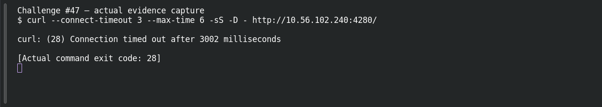

# The Base64

**Platform:** PCGCTF · **Challenge ID:** 47 · **Category:** Web Exploitation — DVWA · **Points:** 250

**Status:** Unresolved. The clue points at a clear concept, but the lab host (http://10.56.102.240:4280/) wasn't reachable from here, so there's no response to exploit and no confirmed flag. Honest stub.

## The challenge

The title says Base64, but the question text is identical to #46 — it's really about missing API authentication.

## What I could do

The title and the actual question disagree; I trust the question. Treat it as missing API auth (#46) unless the live service actually supplies a Base64 value to decode.

I probed the target read-only, with redirects disabled so an unrelated landing page couldn't masquerade as the lab:

```sh
curl --connect-timeout 5 --max-time 12 -sS -D - http://10.56.102.240:4280/
```

The result was a **connect timeout** — no response body to inspect. Claiming a working exploit here would be inventing evidence.

## Screenshot



(The capture shows the failed connection, not an exploit or a flag.)

## Flag

None recovered. The lab is unreachable from this environment, and the grader's exact wording inside `pcgCTF{...}` isn't known either.

## Still to do

- Reach the lab from an authorized network, capture the live prompt/hint, and record one justified candidate plus its actual submission result.

## Takeaway

Titles drift — the concrete question and artifact take priority over a misleading name.

## Reference

- [Original challenge description](../../unsolved/web-exploitation-dvwa/047-the-base64/README.md)
