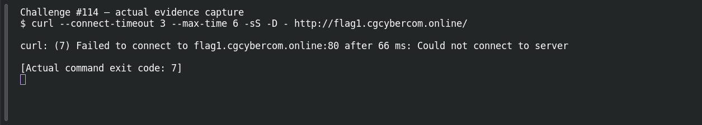

# Web Recon — Hidden Directory

**Platform:** PCGCTF · **Challenge ID:** 114 · **Category:** Web Exploitation · **Points:** 150

**Status:** Unresolved. The technique is clear from the clue, but the target (http://flag1.cgcybercom.online/) wasn't reachable from here, so there's no response to work with and no confirmed flag. Honest stub.

## The challenge

A directory isn't linked but still exists.

## What I could do

The approach is content discovery — check `robots.txt`, then brute-force common directory names (gobuster/ffuf) to find the unlinked path.

I probed the target read-only:

```sh
curl --connect-timeout 5 --max-time 12 -sS -D - http://flag1.cgcybercom.online/
```

The connection timed out — no response body. Reporting a working exploit here would be inventing evidence.

## Screenshot



(The capture shows the failed connection, not an exploit or a flag.)

## Flag

None recovered — target unreachable, and the exact string inside `pcgCTF{...}` isn't known.

## Still to do

- Reach the target from an authorized network, run the check above, and record one justified candidate with its real submission result.

## Takeaway

'Unlinked' isn't 'protected' — directory brute-forcing finds paths that nav menus hide.

## Reference

- [Original challenge description](../../unsolved/web-exploitation/114-web-recon-hidden-directory/README.md)
