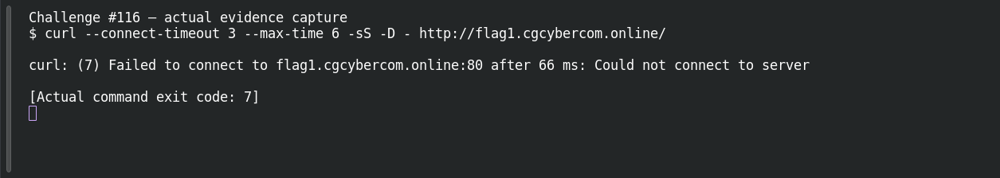

# Web Recon — Read the Headers

**Platform:** PCGCTF · **Challenge ID:** 116 · **Category:** Web Exploitation · **Points:** 300

**Status:** Unresolved. The technique is clear from the clue, but the target (http://flag1.cgcybercom.online/) wasn't reachable from here, so there's no response to work with and no confirmed flag. Honest stub.

## The challenge

The flag is in the HTTP response headers.

## What I could do

The approach is to read the full response headers (`curl -D -` or `-I`) and look for a custom header carrying the flag.

I probed the target read-only:

```sh
curl --connect-timeout 5 --max-time 12 -sS -D - http://flag1.cgcybercom.online/
```

The connection timed out — no response body. Reporting a working exploit here would be inventing evidence.

## Screenshot



(The capture shows the failed connection, not an exploit or a flag.)

## Flag

None recovered — target unreachable, and the exact string inside `pcgCTF{...}` isn't known.

## Still to do

- Reach the target from an authorized network, run the check above, and record one justified candidate with its real submission result.

## Takeaway

Response headers carry more than the body shows — a custom header is an easy place to stash a flag.

## Reference

- [Original challenge description](../../unsolved/web-exploitation/116-web-recon-read-the-headers/README.md)
