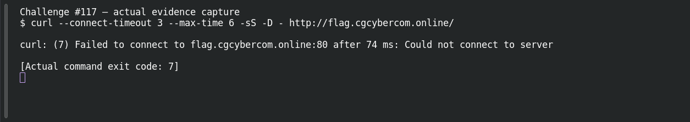

# Infrastructure — Unsecured Reverse Proxy

**Platform:** PCGCTF · **Challenge ID:** 117 · **Category:** Web / Infrastructure Security · **Points:** 300

**Status:** Unresolved. The technique is clear from the clue, but the target (http://flag.cgcybercom.online/) wasn't reachable from here, so there's no response to work with and no confirmed flag. Honest stub.

## The challenge

A reverse proxy forwards to an internal service it shouldn't expose.

## What I could do

The approach is to probe proxy routes / Host headers that reach the backend the proxy was meant to shield, then read the internal response.

I probed the target read-only:

```sh
curl --connect-timeout 5 --max-time 12 -sS -D - http://flag.cgcybercom.online/
```

The connection timed out — no response body. Reporting a working exploit here would be inventing evidence.

## Screenshot



(The capture shows the failed connection, not an exploit or a flag.)

## Flag

None recovered — target unreachable, and the exact string inside `pcgCTF{...}` isn't known.

## Still to do

- Reach the target from an authorized network, run the check above, and record one justified candidate with its real submission result.

## Takeaway

A reverse proxy must restrict which backends and paths it forwards — otherwise it becomes a door to internal services.

## Reference

- [Original challenge description](../../unsolved/web-infrastructure-security/117-infrastructure-unsecured-reverse-proxy/README.md)
