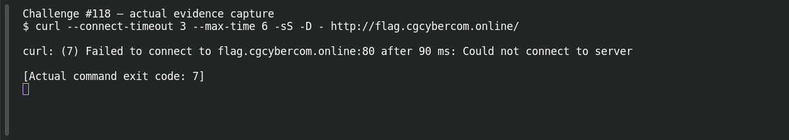

# Path Traversal — Off by Slash

**Platform:** PCGCTF · **Challenge ID:** 118 · **Category:** Web Exploitation · **Points:** 300

**Status:** Unresolved. The technique is clear from the clue, but the target (http://flag.cgcybercom.online/) wasn't reachable from here, so there's no response to work with and no confirmed flag. Honest stub.

## The challenge

A path filter is bypassable with a slash trick — path traversal.

## What I could do

The approach is to try traversal payloads that defeat a naive `../` filter (encoded slashes, extra slashes) and read a file outside the web root.

I probed the target read-only:

```sh
curl --connect-timeout 5 --max-time 12 -sS -D - http://flag.cgcybercom.online/
```

The connection timed out — no response body. Reporting a working exploit here would be inventing evidence.

## Screenshot



(The capture shows the failed connection, not an exploit or a flag.)

## Flag

None recovered — target unreachable, and the exact string inside `pcgCTF{...}` isn't known.

## Still to do

- Reach the target from an authorized network, run the check above, and record one justified candidate with its real submission result.

## Takeaway

Filtering `../` by substring is fragile — canonicalize the resolved path and allowlist it instead.

## Reference

- [Original challenge description](../../unsolved/web-exploitation/118-path-traversal-off-by-slash/README.md)
