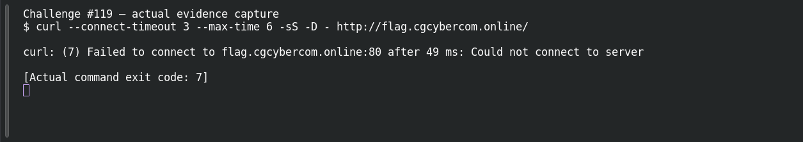

# SSRF — Reach the Internal Service

**Platform:** PCGCTF · **Challenge ID:** 119 · **Category:** Web Exploitation · **Points:** 200

**Status:** Unresolved. The technique is clear from the clue, but the target (http://flag.cgcybercom.online/) wasn't reachable from here, so there's no response to work with and no confirmed flag. Honest stub.

## The challenge

A server-side fetch can be pointed at an internal service — SSRF.

## What I could do

The approach is to supply an internal URL (e.g. `http://127.0.0.1/` or a metadata endpoint) to the parameter the server fetches, and read the internal response.

I probed the target read-only:

```sh
curl --connect-timeout 5 --max-time 12 -sS -D - http://flag.cgcybercom.online/
```

The connection timed out — no response body. Reporting a working exploit here would be inventing evidence.

## Screenshot



(The capture shows the failed connection, not an exploit or a flag.)

## Flag

None recovered — target unreachable, and the exact string inside `pcgCTF{...}` isn't known.

## Still to do

- Reach the target from an authorized network, run the check above, and record one justified candidate with its real submission result.

## Takeaway

SSRF turns the server into your proxy — validate and allowlist outbound URLs, don't fetch arbitrary user input.

## Reference

- [Original challenge description](../../unsolved/web-exploitation/119-ssrf-reach-the-internal-service/README.md)
