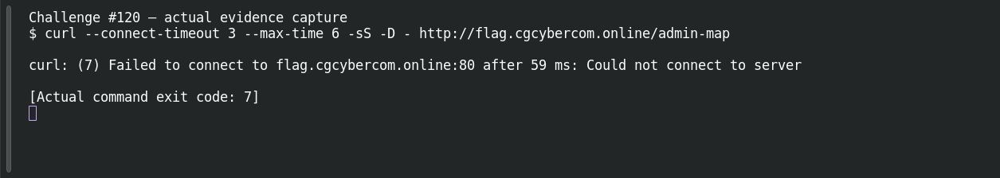

# Access Control — User-Agent Bypass

**Platform:** PCGCTF · **Challenge ID:** 120 · **Category:** Web Exploitation · **Points:** 200

**Status:** Unresolved. The technique is clear from the clue, but the target (http://flag.cgcybercom.online/admin-map) wasn't reachable from here, so there's no response to work with and no confirmed flag. Honest stub.

## The challenge

Access is gated on the User-Agent header.

## What I could do

The approach is to send the expected User-Agent (`curl -A '...'`) to the restricted path and read the response.

I probed the target read-only:

```sh
curl --connect-timeout 5 --max-time 12 -sS -D - http://flag.cgcybercom.online/admin-map
```

The connection timed out — no response body. Reporting a working exploit here would be inventing evidence.

## Screenshot



(The capture shows the failed connection, not an exploit or a flag.)

## Flag

None recovered — target unreachable, and the exact string inside `pcgCTF{...}` isn't known.

## Still to do

- Reach the target from an authorized network, run the check above, and record one justified candidate with its real submission result.

## Takeaway

A client-supplied header like User-Agent is trivially spoofed — it can't be an access control.

## Reference

- [Original challenge description](../../unsolved/web-exploitation/120-access-control-user-agent-bypass/README.md)
