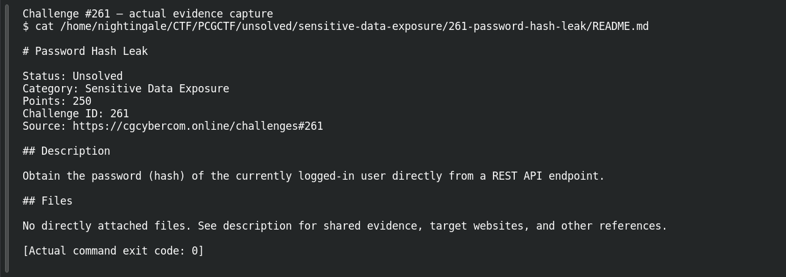

# Password Hash Leak

**Platform:** PCGCTF · **Challenge ID:** 261 · **Category:** Sensitive Data Exposure · **Points:** 250

**Status:** Unresolved — and blocked at the start. The saved task gives no target URL, endpoint, or session, so there's nothing to probe. Honest stub.

## The challenge

Obtain the currently-logged-in user's password hash directly from a REST API endpoint.

## Where this stands

That's the *entire* saved task — no URL, no endpoint, no attachment, no account. The archive has several web hosts across other tracks, but assigning this challenge to one of them would be a guess, and I'm not going to send credentials to an unrelated service on a hunch.

The objective is also specific: it wants the *stored hash* for the *logged-in* user — a random account's digest wouldn't answer it, even if it demonstrated a leak. (A hash is still sensitive: it enables offline guessing.)

## How you'd finish it (once the target is known)

```text
1. Open #261 on the platform, capture the full prompt + target link.
2. Log into the intended instance; in DevTools, filter Fetch/XHR.
3. Trigger the profile/account action and inspect the REST response.
4. Match the response's user id to the logged-in account, find the digest field.
```

A terminal reproduction, with session material kept out of the writeup:

```sh
curl -sS -H "Authorization: Bearer $CTF_SESSION_TOKEN" \
  "$CONFIRMED_BASE_URL/$OBSERVED_API_PATH" -o account-response.json
```

(An explicitly unexecuted template — those variables must come from the real lab.)

## Screenshot



(Documents the missing target, not a recovered hash.)

## Flag

None — there's no target or digest in the evidence to work from.

## Still to do

- Get the original challenge's endpoint/prerequisite link; everything else is ready once that exists.

## Takeaway

An API that serializes the stored password hash is the bug — serializers should allowlist client-facing fields and never include authentication material. (And don't guess at an endpoint by sending credentials to an unrelated host.)

## Reference

- [Original challenge description](../../unsolved/sensitive-data-exposure/261-password-hash-leak/README.md)
