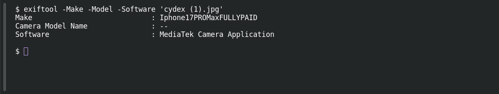

# Picture Perfect Evidence

**Platform:** PCGCTF · **Challenge ID:** 2 · **Category:** Cryptography · **Points:** 100

**Status:** Solved in the last snapshot; I re-read the metadata for this writeup.

## The challenge

Find the camera make recorded in the JPEG metadata.

## Solving it

If the question is about the device, EXIF metadata is where to look. I pulled the make, model and software fields with exiftool:

```sh
exiftool -Make -Model -Software 'cydex (1).jpg'
```

```text
Make                            : Iphone17PROMaxFULLYPAID
Camera Model Name               : --
Software                        : MediaTek Camera Application
```

The `Make` field contains `Iphone17PROMaxFULLYPAID`. This is the value the question asks for, so its capitalization is preserved in the flag. The other tags do not establish which device actually took the photo.

## Screenshots

Fresh local reproduction using the command described above.



## Flag

```text
pcgCTF{Iphone17PROMaxFULLYPAID}
```

## Takeaway

Metadata can be the whole challenge, and it can be edited. Read the exact field the question asks for instead of inferring the device from the other tags.

## References

- [Original challenge and attachments](<../../home/nightingale/CTF/PCGCTF/solved/cryptography/002-picture-perfect-evidence/README.md>)
- [Saved EXIF dump](<../../home/nightingale/CTF/PCGCTF/final-writeups/evidence-solved/002-exif.txt>)
