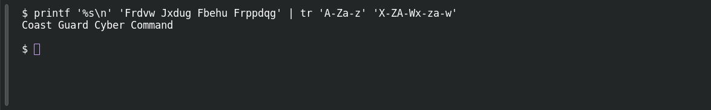

# Ancient Message

**Platform:** PCGCTF · **Challenge ID:** 3 · **Category:** Cryptography · **Points:** 100

**Status:** Solved in the last snapshot; decode reproduced locally.

## The challenge

Decrypt `Frdvw Jxdug Fbehu Frppdqg`. The description hands us the method: a Caesar cipher with a shift of three.

## Solving it

The description gives a shift of three. Shifting each letter back three places produces the message. This can be done with `tr`:

```sh
printf '%s\n' 'Frdvw Jxdug Fbehu Frppdqg' | tr 'A-Za-z' 'X-ZA-Wx-za-w'
```

```text
Coast Guard Cyber Command
```

## Screenshot

Fresh local reproduction using the command described above.



## Flag

```text
pcgCTF{Coast Guard Cyber Command}
```

The challenge doesn't say to swap spaces for underscores, so I kept the spaces.

## Takeaway

The shift changes letters while leaving spaces and punctuation intact.

## References

- [Original challenge and attachments](<../../home/nightingale/CTF/PCGCTF/solved/cryptography/003-ancient-message/README.md>)
