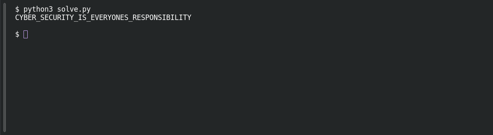

# Silent Signal

**Platform:** PCGCTF · **Challenge ID:** 5 · **Category:** Cryptography · **Points:** 100

**Status:** Solved in the last snapshot; decode reproduced locally.

## The challenge

Translate a string of Morse into text. The description adds one formatting rule: spaces become underscores.

## Solving it

The dots and dashes form Morse letters, with `/` separating words. Decode those groups, then replace the word spaces with underscores as requested:

Save the following as `solve.py` then run `python3 solve.py`. [Download the script](../scripts/005-solve.py).

```python
alphabet = "ABCDEFGHIJKLMNOPQRSTUVWXYZ"
codes = ".- -... -.-. -.. . ..-. --. .... .. .--- -.- .-.. -- -. --- .--. --.- .-. ... - ..- ...- .-- -..- -.-- --.."
morse = dict(zip(codes.split(), alphabet))
message = '-.-. -.-- -... . .-. / ... . -.-. ..- .-. .. - -.-- / .. ... / . ...- . .-. -.-- --- -. . ... / .-. . ... .--. --- -. ... .. -... .. .-.. .. - -.--'
words = ["".join(morse[group] for group in word.split())
         for word in message.split("/")]
print("_".join(words))
```

```text
CYBER_SECURITY_IS_EVERYONES_RESPONSIBILITY
```

Run against the challenge's Morse, that gives:

## Screenshot

Fresh local reproduction using the command described above.



## Flag

```text
pcgCTF{CYBER_SECURITY_IS_EVERYONES_RESPONSIBILITY}
```

## Takeaway

The separators are part of the data. Decode first, then apply only the formatting rule the challenge actually states.

## References

- [Original challenge and attachments](<../../home/nightingale/CTF/PCGCTF/solved/cryptography/005-silent-signal/README.md>)
- [Earlier solution / teammate provenance](<../../home/nightingale/CTF/PCGCTF/solved/cryptography/005-silent-signal/solution.md>)
