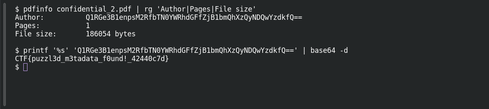

# Riddle Registry

**Platform:** PCGCTF · **Challenge ID:** 35 · **Category:** Forensics · **Points:** 200

**Status:** Solved in the last snapshot; reproduced locally.

## The challenge

The flag is hidden in a PDF's metadata — the description warns up front that the visible page text is a decoy.

## Solving it

So I skipped the rendered page and read the document info directly with `pdfinfo`:

```sh
pdfinfo confidential_2.pdf
```

```text
Author:   Q1RGe3B1enpsM2RfbTN0YWRhdGFfZjB1bmQhXzQyNDQwYzdkfQ==
Producer: kkr4m
Pages:    1
```

The Author field is a long Base64 string instead of a name — this supplies the requested value. Decode it:

```sh
echo 'Q1RGe3B1enpsM2RfbTN0YWRhdGFfZjB1bmQhXzQyNDQwYzdkfQ==' | base64 -d
```

```text
CTF{puzzl3d_m3tadata_f0und!_42440c7d}
```

The source prefix is `CTF` and the description gives no replacement rule, so I kept it as-is.

## Screenshots

Fresh local reproduction using the commands described above.



## Flag

```text
CTF{puzzl3d_m3tadata_f0und!_42440c7d}
```

## Takeaway

When the description points away from the visible content, check the container metadata. An out-of-place Author field was the whole answer — no PDF exploit needed.

## References

- [Original challenge and attachments](<../../home/nightingale/CTF/PCGCTF/solved/forensic/035-riddle-registry/README.md>)
- [Saved pdfinfo output](<../../home/nightingale/CTF/PCGCTF/final-writeups/evidence-solved/035-pdfinfo.txt>)
