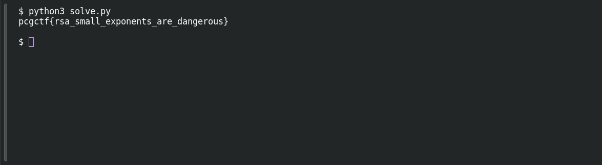

# Small Exponent

**Platform:** PCGCTF · **Challenge ID:** 65 · **Category:** Cryptography · **Points:** 150 · **Difficulty:** Medium

**Status:** Solved in the last snapshot; attack reproduced locally.

## The challenge

Recover the message from the supplied RSA ciphertext with public exponent `e = 3`.

## Solving it

RSA computes `c = m³ mod n`. If `m³ < n`, the ciphertext is the ordinary cube of the message integer. Taking an exact integer cube root then recovers the message without factoring `n`.

Run this Python code beside `03_rsa_small_exponent.txt`. It reads the supplied parameters and uses binary search, avoiding floating-point rounding:

Save the following as `solve.py` beside the input file, then run `python3 solve.py`. [Download the script](../scripts/065-solve.py).

```python
from pathlib import Path
import re

text = Path("03_rsa_small_exponent.txt").read_text()
values = {name: int(value) for name, value in
          re.findall(r"(n|e|ciphertext)\s*=\s*(\d+)", text)}
c = values["ciphertext"]
low, high = 0, 1 << ((c.bit_length() + 2) // 3)

while low + 1 < high:
    middle = (low + high) // 2
    if middle ** 3 <= c:
        low = middle
    else:
        high = middle

assert values["e"] == 3
assert low ** 3 == c < values["n"]
message = low.to_bytes((low.bit_length() + 7) // 8, "big")
print(message.decode())
```

```text
pcgctf{rsa_small_exponents_are_dangerous}
```

The exact cube check confirms that this ciphertext meets the condition for the attack.

## Screenshot

Fresh local reproduction using the command described above.



## Flag

```text
pcgctf{rsa_small_exponents_are_dangerous}
```

## Takeaway

The bug isn't "e=3" by itself — it's unpadded low-exponent RSA with a small enough message. Test the exact precondition (`m^3 == c`) rather than treating any near-root as the answer.

## References

- [Original challenge and attachments](<../../home/nightingale/CTF/PCGCTF/solved/cryptography/065-small-exponent/README.md>)
- [Earlier solution / teammate provenance](<../../home/nightingale/CTF/03_rsa_small_exponent_writeup.md>)
