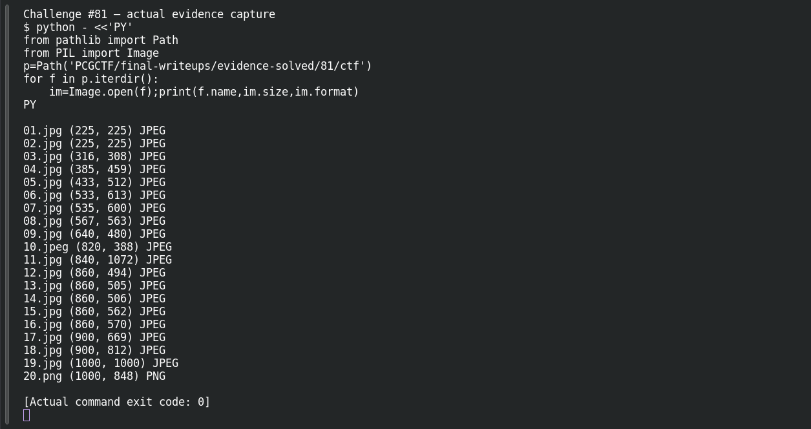
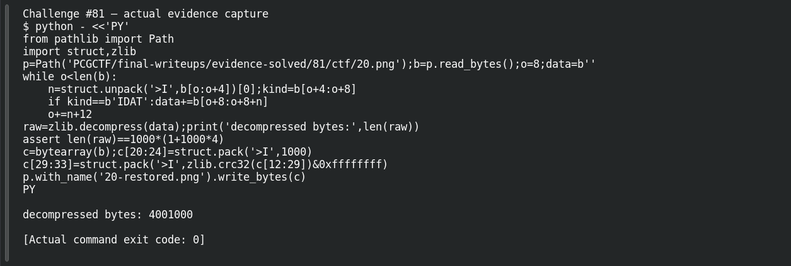

# TURTLES ALL THE WAY DOWN

**Platform:** PCGCTF · **Challenge ID:** 81 · **Category:** Steganography · **Points:** 100

**Status:** Solved in the last snapshot; reproduced locally.

## The challenge

One turtle image in the archive has been tampered with — the flag is hidden below its displayed height.

## Solving it

The archive is 19 JPEGs and one PNG, and the PNG (also the visibly "unhappy" turtle, matching the hint) is the odd one out. The giveaway: a PNG declares its height in the IHDR chunk, but the actual pixel data lives in IDAT — and if someone shrinks the declared height, the extra rows are still in the file. Checking the dimensions:

```sh
python3 -c "from PIL import Image; im=Image.open('20.png'); print(im.size)"
```

```text
(1000, 848)
```

The IHDR says 8-bit RGBA at 1000 wide, so each row is 1000×4 + 1 filter byte = 4001 bytes. Decompressing the IDAT gives 4,001,000 bytes = exactly 1000 rows — but the header only shows 848. So I patched the declared height back to 1000 (fixing the IHDR CRC) on a *copy*:

```sh
python3 -c "
import struct,zlib
b=bytearray(open('20.png','rb').read())
b[20:24]=struct.pack('>I',1000)               # height field
b[29:33]=struct.pack('>I',zlib.crc32(bytes(b[12:29]))&0xffffffff)  # IHDR CRC
open('20-restored.png','wb').write(b)"
```

Opening the restored copy shows the hidden text: `flag{coffee_first_then_smiles}`.

## Screenshots

The terminal image below displays a retained verification transcript.





Before (declared height 848, text hidden) and after (height 1000, flag revealed):


## Flag

```text
pcgCTF{coffee_first_then_smiles}
```

## Takeaway

A file header can hide real content by claiming an incomplete canvas. Cross-check the declared size against the actual decoded pixels, and repair a copy with a correct checksum rather than guessing at LSB tricks.

## References

- [Original challenge and attachments](<../../home/nightingale/CTF/PCGCTF/solved/steganography/081-turtles-all-the-way-down/README.md>)
