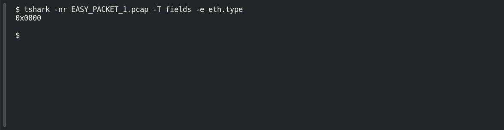

# EASY PACKET 1 #05 — EtherType: IPv4

**Platform:** PCGCTF · **Challenge ID:** 87 · **Category:** Network Forensics · **Points:** 100

**Status:** Solved in the authenticated snapshot; field re-pulled from the capture for this writeup.

**Evidence:** Packet 1 · TCP stream 0 · [EASY_PACKET_1.pcap](../../challenges/solved/network-forensics/082-easy-packet-1-the-exposed-request/files/EASY_PACKET_1.pcap).

## The challenge

Name the network protocol behind EtherType 0x0800. The evidence is `EASY_PACKET_1.pcap`, the shared capture for this whole series.

## Solving it

Read the Ethernet type field:
```sh
tshark -nr EASY_PACKET_1.pcap -T fields -e eth.type
```

```text
0x0800
```

EtherType 0x0800 is IPv4. The question asks for the protocol name, not the hex value.

## Screenshot

Fresh local reproduction using the command described above.



## Flag

```text
pcgCTF{IPv4}
```

## Reference

- [Original challenge description](../../challenges/solved/network-forensics/087-easy-packet-1-05-ethertype-ipv4/README.md)
